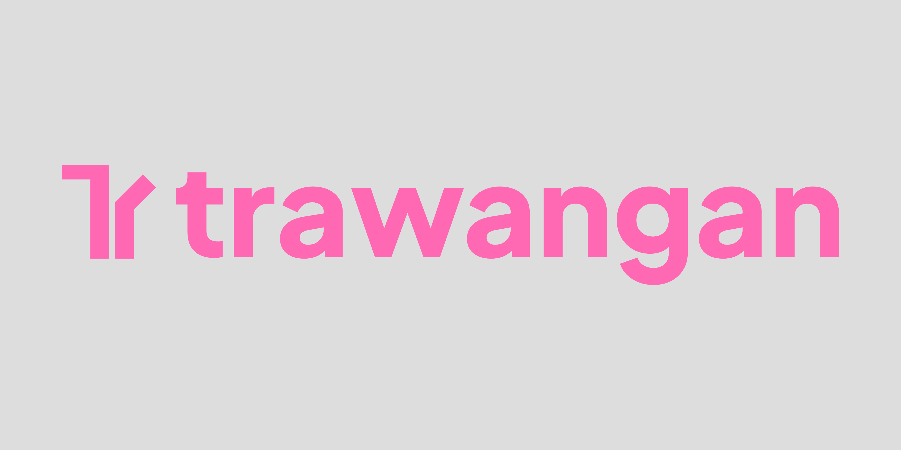
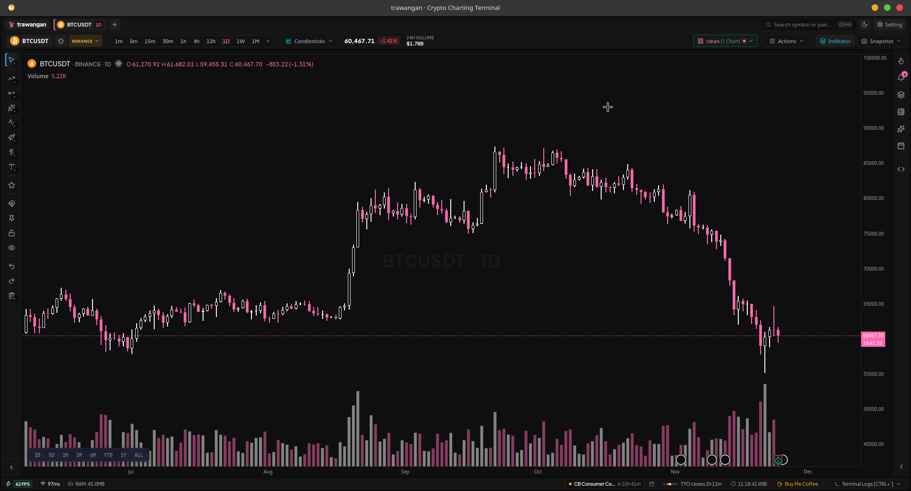
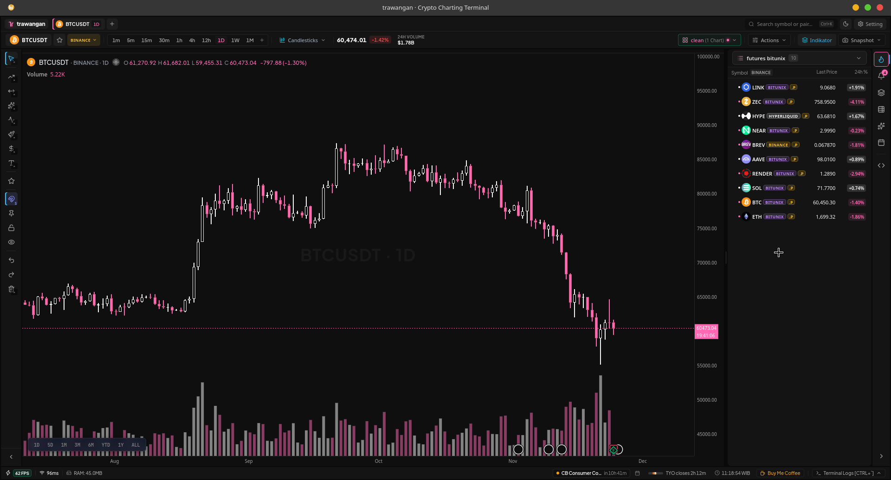
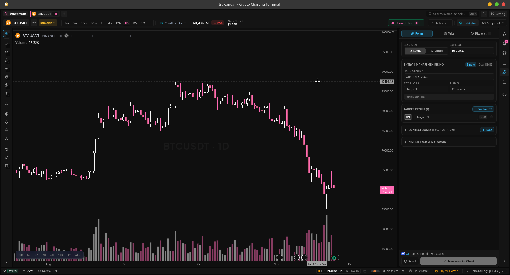
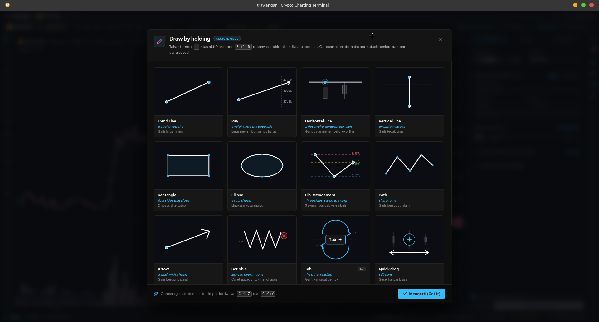
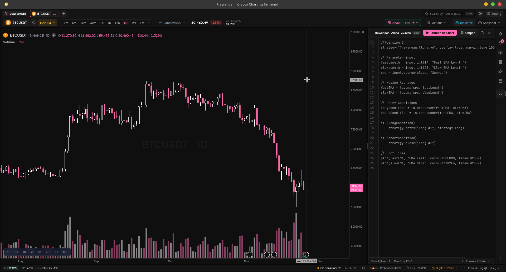
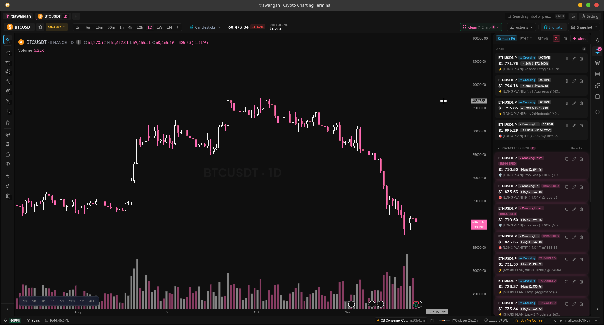
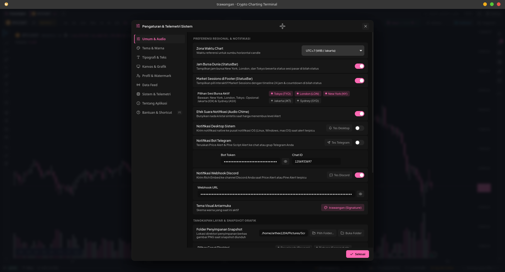
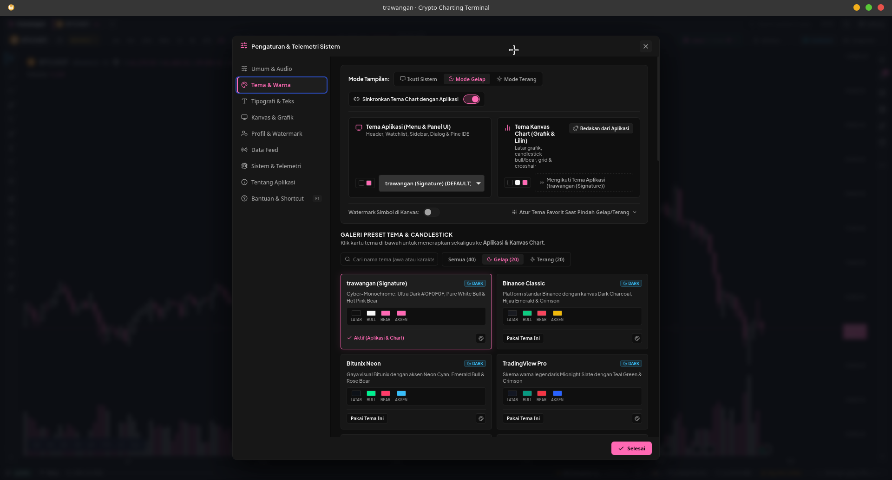

<p align="center">
  
</p>

<p align="center">
  <strong>🌐 Language / Pilih Basa:</strong>
  &nbsp;<a href="README.md">🔥 Basa Jawa Arekan (Default)</a>&nbsp; ·
  &nbsp;<a href="README.id.md">🇮🇩 Bahasa Indonesia</a>&nbsp; ·
  &nbsp;🇬🇧 <strong>English</strong>
</p>

# ꦠꦿꦮꦔꦤ꧀ · trawangan

> **Native Multi-Asset & Crypto Desktop Charting Terminal, Zero Paywall Forever**  
> Built with **Tauri v2 (Rust Core)**, **Svelte 5 (Runes)**, **LuxAlgo Vela (120 FPS WebGL2 Engine)**, and **PineTS v6**.

<p align="center">
  <a href="https://github.com/KaleksananBarqi/trawangan/releases/latest"></a>
  <a href="https://v2.tauri.app/"></a>
  <a href="https://www.rust-lang.org/"></a>
  <a href="https://svelte.dev/"></a>
  <a href="https://www.khronos.org/webgl/"></a>
  
  <a href="LICENSE"></a>
</p>

<p align="center">
  <strong>Official Website:</strong> <a href="https://kaleksananbarqi.github.io/trawangan/">https://kaleksananbarqi.github.io/trawangan/</a>
</p>

---

## Philosophy & Scope

The name **trawangan** comes from the Javanese concept *penerawangan* (ꦠꦿꦮꦔꦤ꧀), sharp clarity piercing through market noise and manipulation.

While commercial charting platforms lock multi-chart layouts, indicator counts, and custom scripting behind recurring monthly subscriptions, **trawangan** puts full analytical sovereignty back on your local machine. Every WebGL2 chart, Pine Script v6 study, watchlist, macro index, stock/commodity feed, and Trade Plan Vault runs locally with zero paywalls.

> [!IMPORTANT]
> **Pure Charting by Default + Opt-In Execution Bridge (`ADR-0031`):**  
> Out of the box, `trawangan` runs with zero Buy/Sell buttons to keep your chart analysis free from impulsive execution. Advanced traders who want manual order routing can unlock the **Opt-In Execution Bridge (100% Optional, Default OFF)** for **1. Binance**, **2. Bitunix**, and **3. CFD Brokers / MetaTrader 5 (MT5)** through a 3-step local security gate. Order execution is **strictly decoupled** from Trade Plans and requires explicit manual entry in the **Order** tab.

---

## Feature Comparison: Zero-Paywall Parity

| Capability | `trawangan` (Native Desktop) | Commercial Free Tiers |
| :--- | :---: | :---: |
| **Simultaneous Indicators** | **Unlimited per canvas** | Restricted (typically 2 - 3 max) |
| **Technical Drawing Suite** | **76 complete tools + Multi-pane Gesture Inking** | Partially paywalled |
| **Gesture Drawing Engine** | **Draw by Holding (`Shift+D` / `~`) & Scribble Erase** | Unavailable |
| **Multi-Chart Grid Layouts** | **Full 1, 2, 2H, 4 cells + `Save As` cloning** | Locked behind paid plans |
| **Trade Plan Management** | **Docked `Plan` Tab (`Preview` \| `Form` \| `Markdown` \| `Vault`), Dual-Entry & In-Place Edit** | Manual box dragging & manual R math |
| **Docked Thesis Preview** | **Cleanly docked inside `Plan` tab (Zero canvas clutter)** | Unavailable |
| **Opt-In Execution Bridge** | **Optional (Default OFF): Binance, Bitunix & Local MT5 CFD + Complete Setup Guides** | Broker lock-in |
| **Startup Tour & i18n** | **Interactive Spotlight Tour + 3 Languages (`Javanese Arekan Default`, `ID`, `EN`)** | Static |
| **Pine Script v6 Runtime** | **Side-by-Side CodeMirror 6 IDE + Local PineTS Web Worker** | Cloud server limits |
| **Snapshot Export** | **Ultra HD 2x - 6x + Dedicated Thesis Side Panel** | Standard 1x only |
| **Themes & Accessibility** | **37 official presets (31 Javanese cultural themes + Warta Abang) & 9D Studio** | Basic dark/light only |
| **Multi-Asset & Macro Feeds** | **Binance, Indodax IDR, Bitunix, Hyperliquid, Coinbase, Yahoo Finance (IDX, COMEX, US), & Macro (`TOTAL` 1-3, `OTHERS`, `BTC.D`)** | Extra market data fees |
| **Memory Footprint (RAM)** | **Ultra-light ~30 - 50 MB (Native Rust)** | 500 MB - 1.5 GB (Electron / Browser tabs) |
| **Cost & License** | **\$0 Forever (Apache 2.0 + Mandatory `NOTICE` Credit)** | \$14.95 - \$59.95 / month |

---

## Core Highlights

### 1. Docked Thesis Preview & Dual-Entry Trade Plans (`ADR-0014` - `ADR-0032`)
Thesis cards never float over your candlesticks. The **`Preview`** sub-tab inside the right-hand **`Plan`** dock (`Preview | Form | Markdown | Vault`) renders epistemic badges (`[FAKTA]`, `[INFERENSI]`, `[SPEKULASI]`), weighted **Dual-Entry (`E1` & `E2` + `Blended Entry`)**, **POI Context Zones**, and live market distance. Exporting via `Ctrl+Shift+S` composites your chart alongside a clean **Dedicated Thesis Side Panel**.

### 2. Opt-In Execution Bridge: Binance, Bitunix, & MT5 CFD (`ADR-0031`)
Disabled by default (*zero UI footprint*). Unlock via **Settings → Brokers & Execution**:
- Complete **in-app step-by-step setup tutorials** for **Binance** (Spot & USDⓈ-M Futures `HMAC-SHA256`), **Bitunix** (Perpetual `SHA256`), and **MetaTrader 5 CFD Brokers** (1-click download of `TrawanganMT5Bridge.mq5` communicating locally over `127.0.0.1:15555` with zero cloud relays).
- Reveals a dedicated **`Order` (`Manual Order Ticket`)** tab in the Right Dock Rail, strictly separated from Trade Plans so every order requires manual input and confirmation.

### 3. Startup Spotlight Tour & 3-Language Support (`jv` Default, `id`, `en`)
An interactive 6-step onboarding tour guides first-time users (and can be replayed anytime from the **Tutorial** button in the Header), paired with instant language switching across **Javanese Ngoko Arekan (Default)**, **Indonesian**, and **English**.

---

## Interface Gallery (8 Desktop Workspaces)

### 1. Main Charting Terminal & WebGL2 Vela Engine
<p align="center">
  
</p>

### 2. Multi-Exchange Watchlist Dock
<p align="center">
  
</p>

### 3. Trade Plan Tab, Dual-Entry & Multi-Target Projection
<p align="center">
  
</p>

### 4. Gesture Engine: Draw by Holding (`Shift+D` / `~`) & Scribble Erase
<p align="center">
  
</p>

### 5. Side-by-Side Pine Script v6 IDE (CodeMirror 6 + Web Worker)
<p align="center">
  
</p>

### 6. Price Alerts, Draggable Lines & Background Alert Engine
<p align="center">
  
</p>

### 7. Terminal Settings, Language, Audio Chime & Broker Bridge
<p align="center">
  
</p>

### 8. Dual-Theme Decoupling & 37 Official Theme Presets
<p align="center">
  
</p>

---

## Local Development & Build

```bash
git clone https://github.com/KaleksananBarqi/trawangan.git
cd trawangan
npm ci
npm run tauri dev
```

Build native release installers:
```bash
npm run tauri build
```

*(Mobile Roadmap Note: iOS & Android cross-compilation feasibility via Tauri v2 Mobile + Adaptive Touch Shell is documented in [ADR-0030](docs/adr/0030-tauri-v2-mobile-readiness-and-adaptive-touch-shell.md)).*

---

## License & Mandatory Attribution (Apache 2.0 + `NOTICE`)

Distributed under the **Apache License, Version 2.0** (see [LICENSE](LICENSE) and [NOTICE](NOTICE)).

> [!WARNING]
> **Mandatory Clear Attribution (Apache License 2.0, Section 4d):**  
> Any fork, modification, or redistribution of this software (in source or binary form) **MUST** prominently retain and display explicit credit to the original author (**Kaleksanan Barqi Aji Massani, `https://github.com/KaleksananBarqi/trawangan`**) inside the `NOTICE` file, documentation/README, and the user-facing **"About / Tentang Aplikasi"** UI screen of any derivative work.
