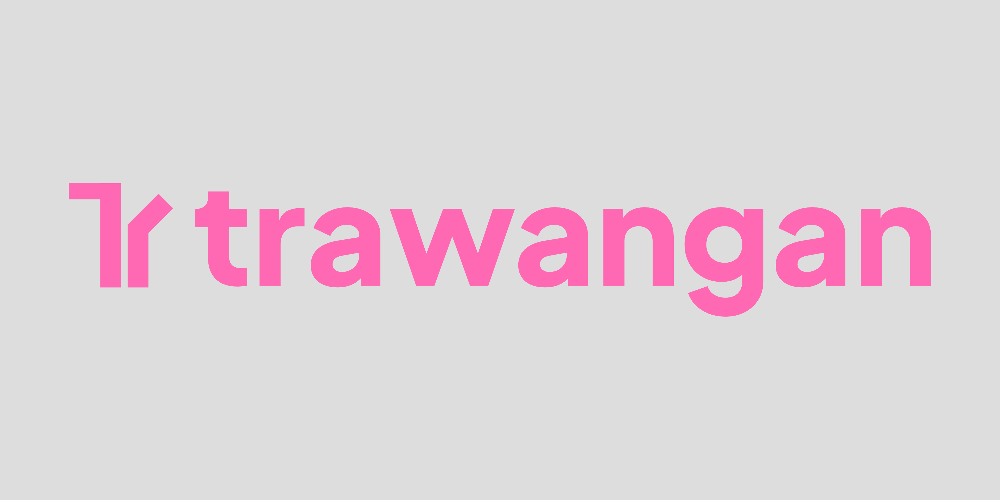
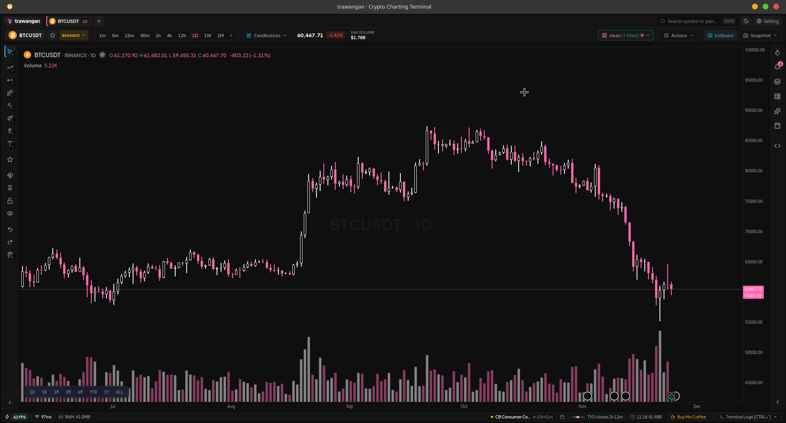
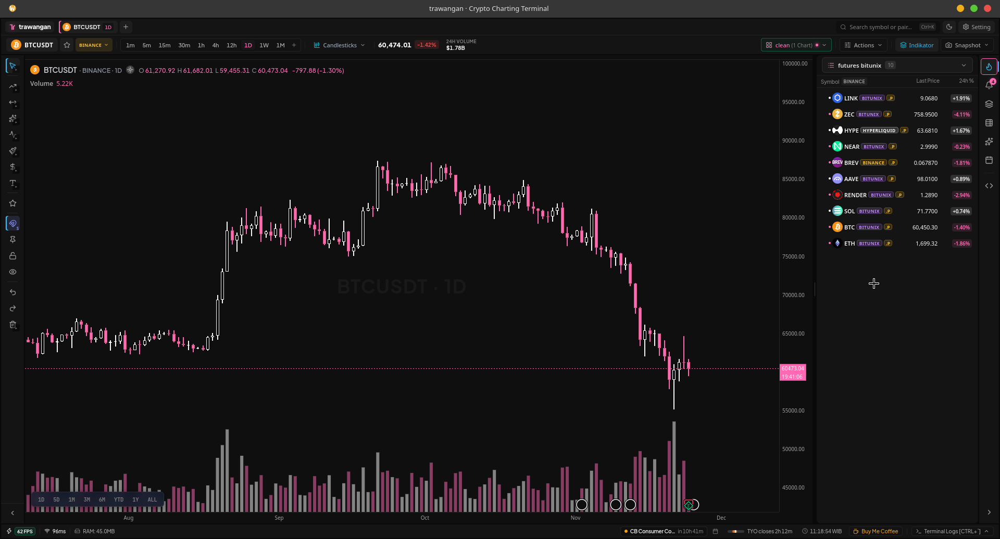
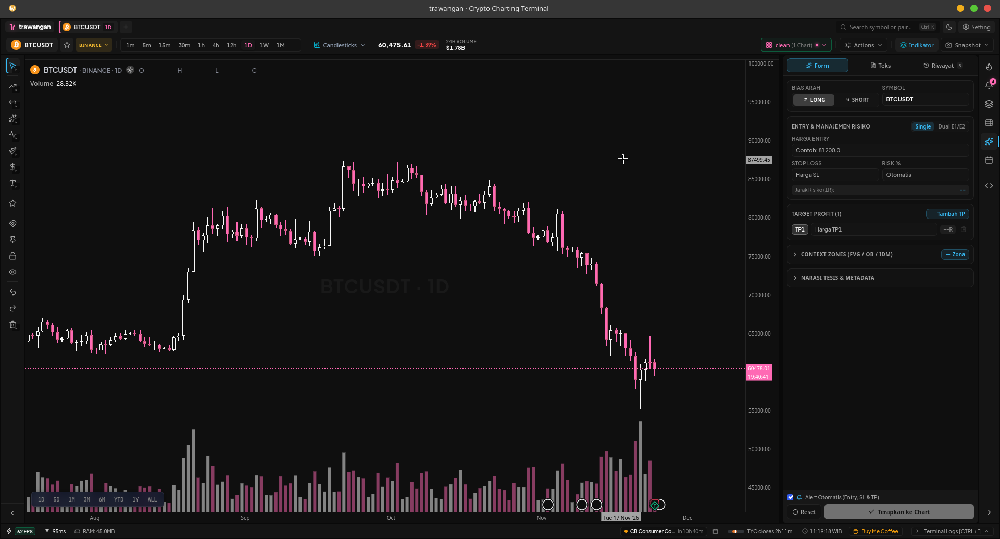
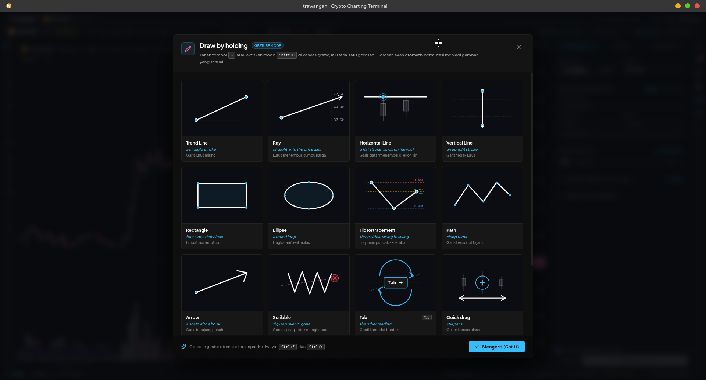
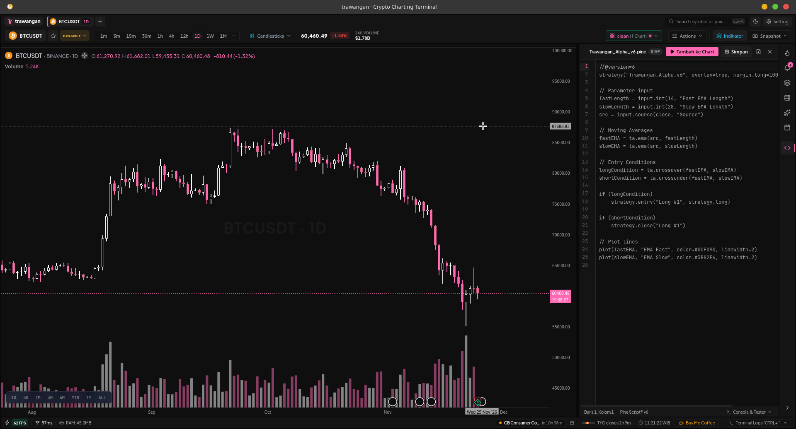
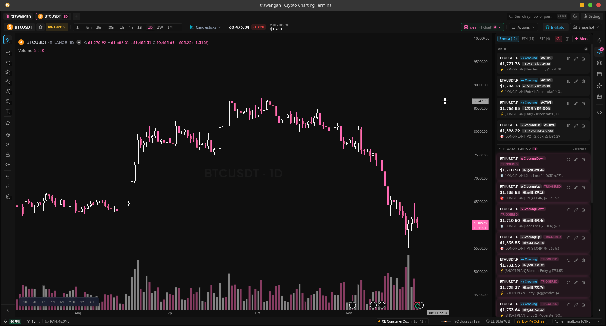
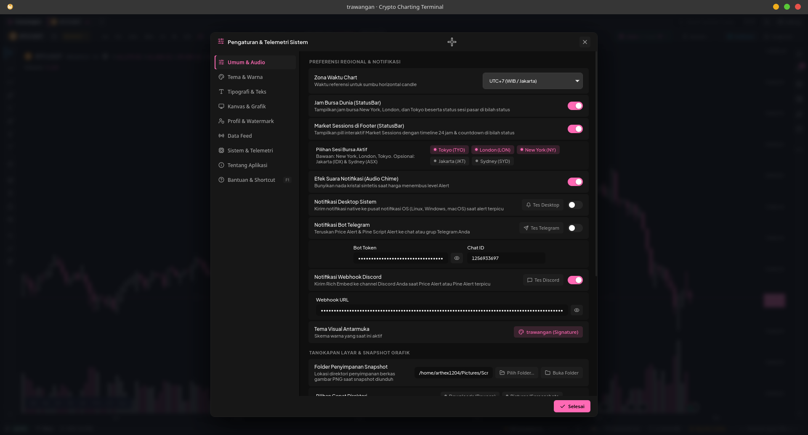
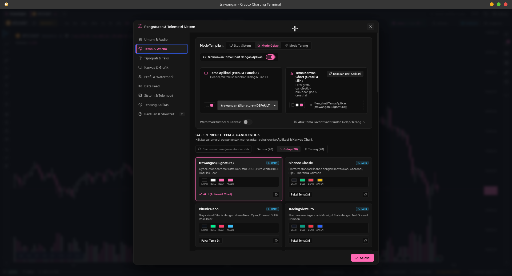

<p align="center">
  
</p>

<p align="center">
  <strong>🌐 Pilih Bahasa / Language:</strong>
  &nbsp;<a href="README.md">🔥 Basa Jawa Arekan (Default)</a>&nbsp; ·
  &nbsp;🇮🇩 <strong>Bahasa Indonesia</strong>&nbsp; ·
  &nbsp;<a href="README.en.md">🇬🇧 English</a>
</p>

# ꦠꦿꦮꦔꦤ꧀ · trawangan

> **Terminal Charting Desktop Multi-Aset & Kripto: Zero Paywall Selamanya**  
> Dibangun di atas **Tauri v2 (Rust Core)**, **Svelte 5 (Runes)**, **LuxAlgo Vela (WebGL2 Engine 120 FPS)**, dan **PineTS v6**.

<p align="center">
  <a href="https://github.com/KaleksananBarqi/trawangan/releases/latest"></a>
  <a href="https://v2.tauri.app/"></a>
  <a href="https://www.rust-lang.org/"></a>
  <a href="https://svelte.dev/"></a>
  <a href="https://www.khronos.org/webgl/"></a>
  
  <a href="LICENSE"></a>
</p>

<p align="center">
  <strong>Landing Page Resmi:</strong> <a href="https://kaleksananbarqi.github.io/trawangan/">https://kaleksananbarqi.github.io/trawangan/</a>
</p>

---

## Filosofi & Ruang Lingkup Produk

Nama **trawangan** berasal dari kosakata Jawa *penerawangan* (ꦠꦿꦮꦔꦤ꧀), yaitu ketajaman melihat menembus kabut ilusi dan kesimpangsiuran situasi pasar.

Di tengah platform charting komersial yang membatasi jumlah indikator, layout multi-chart, dan skrip di balik biaya langganan bulanan, **trawangan** mengembalikan kendali penuh meja analisis ke tangan penggunanya. Seluruh grafik, indikator, daftar pantau, skrip Pine v6, hingga arsip rencana trading berjalan secara lokal tanpa paywall untuk pasar kripto, indeks makro kripto, saham Indonesia (IDX), komoditas logam mulia USD, dan indeks AS.

> [!IMPORTANT]
> **Charting Murni secara Bawaan + Opt-In Execution Bridge (`ADR-0031`):**  
> Secara default, `trawangan` berjalan 100% murni untuk analisis grafik tanpa tombol Buy/Sell agar Anda terhindar dari klik impulsif. Namun bagi trader yang menginginkan eksekusi langsung, tersedia **Opt-In Execution Bridge (100% Opsional, Default OFF)** menuju **1. Binance**, **2. Bitunix**, dan **3. Broker CFD / MetaTrader 5 (MT5)** setelah melewati gerbang konfigurasi keamanan 3 langkah. Eksekusi order dipisahkan secara tegas dari Trade Plan dan wajib diinput **manual** di tab **Order**.

---

## Komparasi Fitur: Zero-Paywall Parity

| Fitur / Kapabilitas | `trawangan` (Desktop Native) | Platform Komersial Gratis |
| :--- | :---: | :---: |
| **Indikator Simultan** | **Tanpa batas di satu kanvas** | Dibatasi (umumnya 2 - 3 indikator) |
| **Alat Gambar Teknikal** | **76 varian lengkap + Gesture Inking multi-pane** | Sebagian dikunci di paket berbayar |
| **Gesture Drawing Engine** | **Draw by Holding (`Shift+D` / `~`) & Scribble Erase** | Tidak tersedia |
| **Multi-Chart Grid Layout** | **Bebas penuh (1, 2, 2H, 4 sel) + kloning `Save As`** | Multi-chart dikunci di langganan bulanan |
| **Manajemen Trading Plan** | **Tab `Plan` (`Preview` \| `Form` \| `Teks` \| `Riwayat`), Dual-Entry & Edit In-Place** | Wajib tarik kotak & hitung R manual |
| **Docked Thesis Preview** | **Terintegrasi rapi di sub-tab `Preview` (Kanvas bebas halangan)** | Tidak tersedia |
| **Opt-In Execution Bridge** | **Opsional (Default OFF): Binance, Bitunix & Local MT5 CFD + Tutorial Lengkap** | Terikat broker afiliasi tertentu |
| **Tutorial Start-Up & Multi-Bahasa** | **Interactive Spotlight Tour + 3 Bahasa (`Jawa Arekan Default`, `ID`, `EN`)** | Statis |
| **Eksekusi Pine Script v6** | **CodeMirror 6 IDE + Web Worker PineTS lokal** | Dibatasi antrean & kompilasi server |
| **Ekspor Tangkapan Layar** | **Ultra HD 2x - 6x + Dedicated Thesis Side Panel** | Resolusi standar 1x |
| **Sistem Tema & Kontras** | **37 preset resmi (31 tema Jawa + Warta Abang) & Studio 9D** | Pilihan tema terbatas |
| **Cakupan Pasar & Makro** | **Binance, Indodax IDR, Bitunix, Hyperliquid, Coinbase, Yahoo Finance (IDX, COMEX, US), & Makro (`TOTAL` 1-3, `OTHERS`, `BTC.D`)** | Data tambahan sering berbayar |
| **Konsumsi Memori (RAM)** | **Ringan ~30 - 50 MB (Native Rust)** | 500 MB - 1.5 GB (Electron / Browser) |
| **Biaya & Lisensi** | **Rp 0 / \$0 Selamanya (Apache 2.0 + Wajib Kredit `NOTICE`)** | \$14.95 - \$59.95 / bulan |

---

## Kapabilitas Utama

### 1. Docked Thesis Preview di Tab `Plan` & Dual-Entry (`ADR-0014` - `ADR-0032`)
Kartu tesis tidak lagi melayang menutupi candlestick di kanvas grafik. Seluruh pembacaan tesis kini menyatu rapi di sub-tab **`Preview`** pada tab **`Plan`** di dock kanan (`Preview | Form | Teks | Riwayat`), lengkap dengan lencana epistemik (`[FAKTA]`, `[INFERENSI]`, `[SPEKULASI]`), bobot **Dual-Entry (`E1` & `E2` + `Blended Entry`)**, **POI Context Zones**, dan jarak harga pasar live. Saat mengekspor gambar via `Ctrl+Shift+S`, tesis dirender berdampingan melalui **Dedicated Thesis Side Panel**.

### 2. Opt-In Execution Bridge: Binance, Bitunix, & Broker CFD MT5 (`ADR-0031`)
Secara bawaan nonaktif total (*zero UI footprint*). Saat diaktifkan melalui **Pengaturan → Broker & Eksekusi**:
- Dilengkapi **Gerbang Persetujuan Risiko**, penyimpanan kredensial terenkripsi lokal di SQLite Rust Core, serta **Tutorial Setup Lengkap Langkah-demi-Langkah** di dalam aplikasi.
- Mendukung **Binance** (Spot & USDⓈ-M Futures via `HMAC-SHA256`), **Bitunix** (Perpetual OpenAPI via `SHA256`), dan **Broker CFD / MetaTrader 5** melalui generator 1-klik **`TrawanganMT5Bridge.mq5`** yang berjalan 100% gratis dan lokal di `127.0.0.1:15555`.
- Menampilkan tab **`Order` (`Manual Order Ticket`)** di dock kanan yang **dipisahkan secara tegas dari Trade Plan** sehingga seluruh order wajib diinput dan dikonfirmasi manual oleh pengguna.

### 3. Startup Spotlight Tour & Lokalisasi 3 Bahasa (`jv` Default, `id`, `en`)
Tur interaktif 6 langkah menyambut pengguna saat peluncuran pertama (dan dapat diputar ulang kapan saja dari tombol **Tutorial** di Header), disertai dukungan tiga bahasa reaktif: **Basa Jawa Ngoko Arekan (Default)**, **Bahasa Indonesia**, dan **English**.

---

## Galeri Tampilan Antarmuka (8 Permukaan Kerja)

### 1. Terminal Charting Utama & WebGL2 Vela Engine
<p align="center">
  
</p>

### 2. Panel Watchlist Lintas Bursa & Multi-Watchlist
<p align="center">
  
</p>

### 3. Tab Trade Plan, Dual-Entry & Proyeksi Multi-Target
<p align="center">
  
</p>

### 4. Gesture Engine: Draw by Holding (`Shift+D` / `~`) & Scribble Erase
<p align="center">
  
</p>

### 5. Side-by-Side Pine Script v6 IDE (CodeMirror 6 + Web Worker)
<p align="center">
  
</p>

### 6. Manajemen Price Alert, Draggable Line & Background Engine
<p align="center">
  
</p>

### 7. Pengaturan Terminal, Bahasa, Audio Chime & Broker Bridge
<p align="center">
  
</p>

### 8. Dual-Theme Decoupling & 37 Preset Tema Resmi
<p align="center">
  
</p>

---

## Pengembangan Lokal & Build

```bash
git clone https://github.com/KaleksananBarqi/trawangan.git
cd trawangan
npm ci
npm run tauri dev
```

Untuk membangun paket rilis installer native:
```bash
npm run tauri build
```

*(Catatan Arsitektur Mobile: Kelayakan kompilasi iOS & Android menggunakan Tauri v2 Mobile + Adaptive Touch Shell terdokumentasi di [ADR-0030](docs/adr/0030-tauri-v2-mobile-readiness-and-adaptive-touch-shell.md)).*

---

## Kredit, Atribusi Engine, Pustaka & Aset Open-Source

`trawangan` dibangun di atas ekosistem perangkat lunak bebas, kurator aset visual terbuka, penyedia huruf sumber terbuka, dan umpan data publik berikut ini. Aturan tata kelola atribusi proyek ini didokumentasikan pada [ADR-0033](docs/adr/0033-upstream-engine-and-asset-attribution-governance.md):

### 1. Engine Inti, Scripting & Runtime Native
| Komponen / Paket | Pembuat / Pengelola | Lisensi | Peran di `trawangan` |
| :--- | :--- | :---: | :--- |
| **[Vela](https://velacharts.dev)** (`@luxalgo/vela`) | **LuxAlgo** ([GitHub](https://github.com/luxalgo/vela)) | `Apache-2.0 + NOTICE` | Engine kanvas charting WebGL2 120 FPS, workspace multi-chart, alat gambar teknikal, dan overlay native |
| **[PineTS](https://github.com/LuxAlgo/PineTS)** (`pinets`, `@luxalgo/vela-pinets`) | **LuxAlgo** ([Vela-PineTS](https://github.com/LuxAlgo/Vela-pinets)) | `AGPL-3.0-only` | Transpiler AST dan runtime Pine Script v6 yang berjalan terisolasi di dalam Web Worker lokal |
| **[Acorn](https://github.com/acornjs/acorn)** & **[Astring](https://github.com/davidbonnet/astring)** | Marijn Haverbeke, Ingvar Stepanyan, David Bonnet | `MIT` | Parser AST JavaScript, walker, dan generator kode pendukung transpiler PineTS |
| **[Tauri v2](https://v2.tauri.app/)** & Official Plugins | The Tauri Programme (Commons Conservancy) | `Apache-2.0 / MIT` | Host aplikasi desktop native lintas OS ultra-ringan (~45 MB RAM) tanpa overhead Electron |
| **[Rust Core](https://www.rust-lang.org/)** & Crates (`tokio`, `reqwest`, `serde`, `sha2`, `chrono`, `rfd`) | The Rust Project Developers & Crate Authors | `MIT / Apache-2.0` | Runtime asinkron, komunikasi HTTP/WebSocket langsung, penandatanganan HMAC/SHA256, dialog file OS |
| **[SQLite](https://sqlite.org/)** & **[Rusqlite](https://github.com/rusqlite/rusqlite)** | D. Richard Hipp & Rusqlite Developers | `Public Domain / MIT` | Database lokal 100% offline untuk cache candle historis, workspace, dan Trade Plan Vault |
| **[Svelte 5](https://svelte.dev/)**, **[SvelteKit](https://svelte.dev/docs/kit)** & **[Vite](https://vite.dev/)** | Rich Harris, Evan You & Contributors | `MIT` | Compiler antarmuka reaktif zero-VDOM berbasis Runes dan toolchain build modern |
| **[CodeMirror 6](https://codemirror.net/)** | Marijn Haverbeke & Contributors | `MIT` | Editor kode modular untuk Side-by-Side Pine Script v6 IDE |

### 2. Aset Visual, Ikonografi, Logo Multi-Aset & Tipografi
| Aset / Pustaka | Pembuat / Kurator | Lisensi | Cakupan di `trawangan` |
| :--- | :--- | :---: | :--- |
| **[Lucide Icons](https://lucide.dev/)** (`@lucide/svelte`) | Lucide Contributors (fork Feather Icons) | `ISC / MIT` | Ikonografi antarmuka terminal, toolbar gambar, dock kanan, dan modal pengaturan |
| **[Web3Icons](https://github.com/0xa3k5/web3icons)** (`@0xa3k5/web3icons`) | 0xa3k5 & Contributors | `MIT` | Koleksi ikon SVG token & aset kripto utama (`static/icons/coins/` + CDN) |
| **[Cryptocurrency Icons](https://github.com/spothq/cryptocurrency-icons)** | SpotHQ & Contributors | `MIT / CC0-1.0` | Set ikon SVG kripto cadangan lapis kedua |
| **[Circle Flags](https://github.com/HatScripts/circle-flags)** | HatScripts & Contributors | `MIT` | Ikon bendera negara & mata uang fiat bulat (`static/icons/flags/`, `IDR`/`USD`/`EUR`) |
| **[Global Stock Logos](https://github.com/MrChartist/global-stock-logos)** | MrChartist | `Open Curated (Fair Use)` | Logo vektor SVG perusahaan saham global & AS (`static/icons/stocks/`) |
| **[Ticker Logos](https://github.com/davidepalazzo/ticker-logos)**, **[NVSTly Icons](https://github.com/nvstly/icons)**, **[ShaadyEmad Ticker Logos](https://github.com/ShaadyEmad/ticker-logos)** & **Favicon Emiten IDX (`IDX_COMPANY_DOMAINS`)** | Davide Palazzo, NVSTly, Shaady Emad & Emiten IDX | `MIT / Open Curated / Fair Use` | Logo cadangan saham AS, ETF, token kripto, dan favicon domain resmi emiten IDX |
| **[Plus Jakarta Sans](https://github.com/tokotype/PlusJakartaSans)** | Gumpita Rahayu / Tokotype | `OFL-1.1` | Font geometris untuk wordmark lowercase `trawangan` dan antarmuka UI |
| **[JetBrains Mono](https://www.jetbrains.com/lp/mono/)** | JetBrains s.r.o. (Philipp Nurullin & Konstantin Bulenkov) | `OFL-1.1` | Font monospasi tabular untuk sumbu harga, R-multiple, telemetri, dan kode Pine Script |
| **Aset Orisinal `trawangan`** | Kaleksanan Barqi Aji Massani | `Apache-2.0` | Ikon komoditas (`GOLD`, `SILVER`, `OIL`, `NATGAS`, `COPPER`), ikon makro (`TOTAL`..`USDT.D`), logo monogram, 37 preset tema, dan audio Web Audio API |

### 3. Sumber Data Pasar, Makro & Kalender Publik
- **Bursa Kripto (Direct REST/WebSocket):** Binance, Indodax, Bitunix, Hyperliquid, dan Coinbase Exchange.
- **Kalibrasi Indeks Makro Lokal (`Crypto Macro Index`):** [CoinGecko Public API](https://www.coingecko.com/) dan [DefiLlama Stablecoins API](https://defillama.com/).
- **Saham IDX, Komoditas COMEX & Indeks AS:** Yahoo Finance (`DELAYED 15M`).
- **Kalender Makroekonomi Mingguan:** Fair Economy / ForexFactory Public Calendar Feed.

> [!NOTE]
> **Sanggahan Merek Dagang (Nominative Fair Use):** Seluruh nama bursa, ticker saham, logo token kripto, dan logo emiten perusahaan (termasuk IDX dan AS) tetap merupakan hak cipta dan merek dagang pemilik masing-masing, dan hanya ditampilkan untuk identifikasi instrumen analisis teknikal.

---

## Lisensi & Atribusi Wajib (Apache 2.0 + `NOTICE`)

Didistribusikan di bawah **Apache License, Version 2.0** (lihat [LICENSE](LICENSE) dan [NOTICE](NOTICE)).

> [!WARNING]
> **Kewajiban Atribusi Eksplisit (Klausul 4d Apache License 2.0):**  
> Setiap pihak yang melakukan fork, memodifikasi, atau mendistribusikan ulang perangkat lunak ini (baik kode sumber maupun biner) **wajib** menyertakan atribusi pembuat asli (**Kaleksanan Barqi Aji Massani, `https://github.com/KaleksananBarqi/trawangan`**) secara jelas dan terlihat di dalam berkas `NOTICE`, dokumentasi/README, serta dialog **"Tentang Aplikasi / About"** pada antarmuka pengguna karya turunannya.
