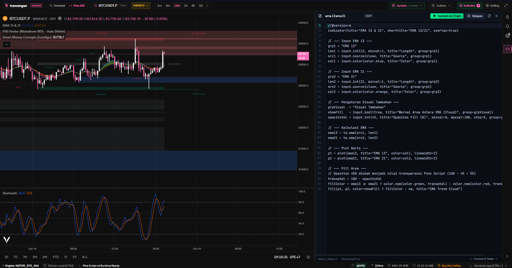
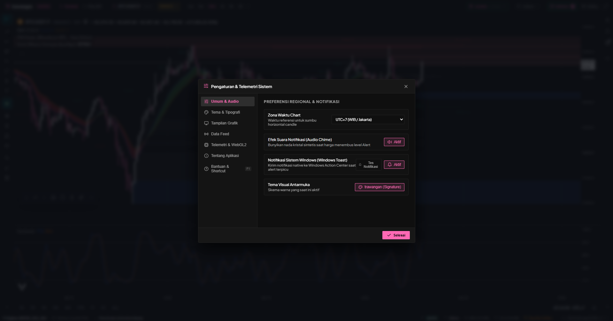
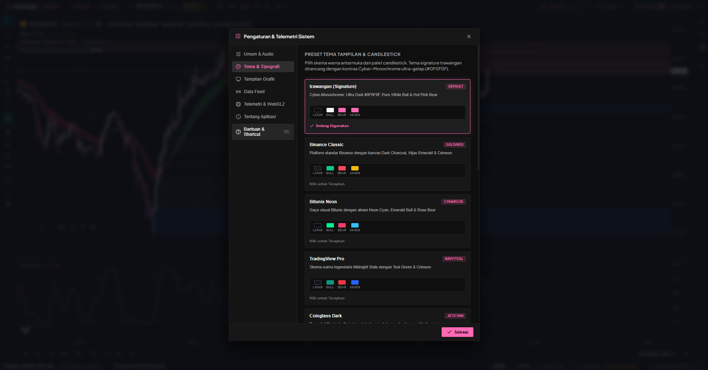

<p align="center">
  
</p>

# ꦠꦿꦮꦔꦤ꧀ · trawangan

> **Professional Desktop Crypto Charting Terminal — Zero Paywall**  
> Ditenagai oleh **Tauri v2 (Rust Core)**, **Svelte 5 (Runes)**, **LuxAlgo Vela (WebGL2 Engine)**, dan **PineTS v6**.

<p align="center">
  <a href="https://v2.tauri.app/"></a>
  <a href="https://www.rust-lang.org/"></a>
  <a href="https://svelte.dev/"></a>
  <a href="https://www.khronos.org/webgl/"></a>
  
  
  <a href="LICENSE"></a>
</p>

<p align="center">
  🌐 <strong>Landing Page Resmi:</strong> <a href="https://kaleksananbarqi.github.io/trawangan/">https://kaleksananbarqi.github.io/trawangan/</a>
</p>

---

## 🔮 Filosofi & Makna Mendalam

Diambil dari etimologi bahasa Jawa **penerawangan** (ꦠꦿꦮꦔꦤ꧀ — *kemampuan batiniah untuk melihat menembus kabut manipulasi, ilusi kasat mata, dan kekacauan duniawi*). 

Di tengah ekosistem pasar kripto modern yang bising dan sarat distorsi likuidasi—di mana pergerakan harga acap kali dimanipulasi dan platform charting komersial mengunci alat analisis dasar di balik biaya langganan bulanan—**trawangan** dirancang untuk mengembalikan kedaulatan visual kepada trader. Memberikan visualisasi data yang objektif, presisi tinggi, dan tajam tanpa batasan *paywall*.

> [!IMPORTANT]
> **Batasan Ruang Lingkup (Pure Charting Scope):**  
> `trawangan` berfokus murni pada visualisasi charting grafis performa tinggi, orderflow, indikator teknikal kustom, dan pengujian strategi Pine Script v6. Aplikasi ini **secara sengaja tidak menyediakan fitur eksekusi order trading langsung** maupun integrasi dompet/brokerage modal nyata demi menjaga kemurnian analisis tanpa distraksi psikologis eksekusi.

---

## ⚖️ Komparasi Fitur: Zero-Paywall Parity

Mengapa harus membayar langganan bulanan mahal hanya untuk memasang indikator dan menguji strategi?

| Fitur / Kapabilitas | `trawangan` (Desktop Native) | Platform Komersial Gratis (TradingView dkk) |
| :--- | :---: | :---: |
| **Indikator Simultan** | **Tanpa Batas (Unlimited)** | Terbatas (Maksimal 2 - 3 indikator) |
| **Tools Gambar Teknikal** | **76+ Varian Lengkap + Hand-Pull** | Dibatasi / Berbayar |
| **Multi-Chart Grid Layout** | **Bebas (1, 2, 2H, 4 Sel Sinkron)** | Terkunci di tier Pro/Premium |
| **Kapasitas Watchlist** | **Tanpa Kuota (Unlimited)** | Dibatasi kuota ketat (maks. 30 simbol) |
| **Eksekusi Pine Script v6** | **Penuh (PineTS Web Worker Lokal)** | Dibatasi server rate-limit & paywall |
| **Data Feed Multi-Exchange** | **Real-time WebSocket Langsung** | Sering tertunda (*delayed*) / berbayar |
| **Penyimpanan & Privasi** | **100% Offline Lokal (SQLite)** | Pelacak cloud, telemetri, & iklan |
| **Beban Memori (RAM)** | **Ultra-Ringan (~30-50 MB Tauri)** | Boros RAM (500 MB - 1.5 GB Electron) |
| **Biaya Langganan** | **Rp 0 / $0 Selamanya (MIT)** | $14.95 - $59.95 / bulan |

---

## 📸 Galeri Tampilan Antarmuka

### 1. Terminal Charting Utama & Vela WebGL2 Engine
Rendering candlestick mulus hingga 120 FPS dengan akselerasi hardware penuh, orderflow real-time, mode navigasi geser Hand-Pull (<kbd>H</kbd>), penghapus interaktif 1-klik, dan panel status responsif.

<p align="center">
  
</p>

### 2. Side-by-Side Pine Script v6 Editor & Web Worker Scripting
Tulis, edit, dan kompilasi skrip PineTS v6 secara mandiri berdampingan dengan grafik menggunakan editor modern CodeMirror 6 tanpa membebani UI thread utama.

<p align="center">
  
</p>

### 3. Pengaturan Terminal, Audio Chime Alerts & Multi-Provider Data Feed
Kustomisasi zona waktu chart reaktif (WIB/Jakarta, UTC), nada alert kristal sintetis Audio Chime, notifikasi native Windows Toast, manajemen data feed multi-exchange (Binance, Indodax IDR, Bitunix, Hyperliquid, Coinbase), serta telemetri hardware WebGL2 real-time.

<p align="center">
  
</p>

### 4. Preset Multi-Tema WebGL2 & Kustomisasi Candlestick Hibrida
Harmonisasi palet warna tema instan (Signature Cyber-Monochrome `#0F0F0F` + `#FF69B4`, Binance Classic, Bitunix Neon, TradingView Pro, Coinglass Dark) ke seluruh sel kanvas WebGL2, pemilih warna kustom mandiri lilin bullish dan bearish dengan formula kontras border otomatis (-15%), serta tombol reset ke tema sekali klik.

<p align="center">
  
</p>

---

## 🎨 Identitas Visual & Tema Signature
* **Kanvas Background:** `#0F0F0F` (True dark minimalis)
* **Garis Grid:** Redup halus monokrom `rgba(255, 255, 255, 0.05)`
* **Candlestick Bullish:** Serba putih gading `#F7F7F7` (badan, garis batas, dan sumbu)
* **Candlestick Bearish:** Hot pink `#FF69B4` (badan & sumbu) dan `#CC5A7F` (garis batas)
* **Brand Monogram:** `tr` hot pink dengan tipografi utama **Plus Jakarta Sans Extra Bold (800)**
* **Preset Alternatif:** Tersedia tema exchange di Pengaturan (`Binance Classic`, `Bitunix Neon`, `TradingView Pro`, `Coinglass Dark`).

---

## 🚀 Fitur Unggulan

- **Ultra-Ringan & Efisien:** Menggunakan arsitektur native desktop berbasis Tauri v2 (Rust Core) dengan konsumsi RAM minimal (~30-50MB), jauh lebih hemat dibandingkan platform berbasis Electron.
- **WebGL2 Charting Engine (120 FPS):** Rendering grafik lilin berkecepatan tinggi dengan akselerasi GPU penuh menggunakan LuxAlgo Vela Engine.
- **76+ Tools Gambar Teknikal & Navigasi Hand-Pull:** Ketersediaan lengkap 76 varian alat teknikal Vela, quick stamp palette (🎯, 🚀, 📌), mode navigasi geser Hand-Pull (<kbd>H</kbd> / <kbd>Spacebar</kbd>), dan mode penghapus interaktif 1-klik (<kbd>Esc</kbd> untuk kembali).
- **Side-by-Side Pine Script v6 IDE:** Tulis dan kompilasi script Pine Script v6 di editor CodeMirror 6 berdampingan dengan grafik. Dijalankan oleh LuxAlgo PineTS di Web Worker lokal tanpa memblokir UI thread.
- **Type-to-Search & Sub-5ms Multi-Bursa:** Intersepsi keyboard cepat saat fokus di grafik atau tekan <kbd>Ctrl+K</kbd> untuk membuka pencarian simbol multi-tier dengan cache instan (< 5ms) dan auto-switch provider.
- **Draggable Price Alerts & Defensive Price Line Guard:** Tarik garis alert langsung di kanvas grafik secara interaktif dengan umpan balik audio chime kristal, serta penjagaan garis harga terkini yang anti-hilang saat mutasi layout atau timeframe.
- **Provider Native Indodax & Format Rupiah (IDR):** Dukungan data feed lokal dengan pemformatan nominal Rupiah terstandarisasi (`Rp 1.480.000.000`), presisi koin mikro, dan pengawas koneksi (Feed Connection Guard).
- **Multi-Chart Grid & Deep Workspace Persistence:** Tata letak grid (1, 2, 2H, 4 sel) dengan sinkronisasi kursor, viewport, simbol, dan indikator. Dilengkapi persistensi state atomik dan siklus hidup indikator bebas zombie di SQLite lokal (`rusqlite`).
- **Cross-Platform:** Kompatibel penuh untuk **Windows**, **Linux**, dan **macOS**.

---

## 🛠️ Tech Stack

- **Desktop Framework:** [Tauri v2](https://v2.tauri.app/) (Rust)
- **Frontend Framework:** [Svelte 5](https://svelte.dev/) (Runes) + SvelteKit SPA (adapter-static)
- **Bundler & Tooling:** [Vite](https://vitejs.dev/) + TypeScript
- **Chart Renderer:** [@luxalgo/vela](https://github.com/luxalgo/vela) (WebGL2)
- **Scripting Engine:** [@luxalgo/vela-pinets](https://github.com/luxalgo/vela) + [PineTS](https://github.com/luxalgo/pinets)
- **Code Editor:** [CodeMirror 6](https://codemirror.net/) (Pine Editor)
- **Database:** SQLite (Embedded Rust via `rusqlite`)
- **Icons:** [Lucide Svelte](https://lucide.dev/)

---

## 💻 Pengembangan Lokal (Local Development)

### Prasyarat
- [Node.js](https://nodejs.org/) (v20+)
- [Rust & Cargo](https://rustup.rs/) (stable)
- **Windows:** C++ Build Tools & WebView2 (sudah terinstal secara default pada Windows 10/11)
- **Linux:** `libwebkit2gtk-4.1-dev`, `build-essential`, `curl`, `wget`, `file`, `libssl-dev`, `libayatana-appindicator3-dev`, `librsvg2-dev`
- **macOS:** Xcode Command Line Tools

### Menjalankan Mode Dev
```bash
# 1. Clone repositori
git clone https://github.com/KaleksananBarqi/trawangan.git
cd trawangan

# 2. Install dependensi frontend
npm install

# 3. Jalankan aplikasi desktop dengan hot-reload
npm run tauri dev
```

---

## 📦 Build Release Multi-Platform

### 1. Build Lokal (Windows)
Untuk membuat installer lokal pada Windows:
```bash
npm run tauri build
```
Output installer (`.exe` NSIS installer & `.msi`) akan berada di direktori:
`src-tauri/target/release/bundle/`

### 2. Build Multi-Platform Otomatis (CI/CD via GitHub Actions)
Aplikasi ini sudah dilengkapi dengan GitHub Actions CI/CD matrix workflow (`.github/workflows/release.yml`) untuk mem-build binary release secara otomatis di ketiga platform:

#### Cara Trigger Release Otomatis:
1. **Lewat Git Tag (Direkomendasikan):**
   ```bash
   git tag -a v0.15.0 -m "Release v0.15.0"
   git push origin v0.15.0
   ```
2. **Lewat GitHub CLI:**
   ```bash
   gh workflow run release.yml -f tag=v0.15.0
   ```
3. **Lewat GitHub Actions UI:**
   Buka tab **Actions** di GitHub -> Pilih **release trawangan** -> Klik **Run workflow** -> Masukkan versi tag (contoh `v0.15.0`).

### Hasil Paket Rilis Biner:
- **Windows:** `.exe` (NSIS Setup) & `.msi`
- **Linux:** `.deb` (Debian/Ubuntu) & `.AppImage` (Universal Linux)
- **macOS:** `.dmg` & `.app` (Apple Silicon & Intel)

---

## 🚨 Troubleshooting: Mengatasi Layar Putih (Blank Screen) Pasca-Build

Jika setelah melakukan proses *build* aplikasi dibuka dan hanya menampilkan **layar putih polos (blank white screen)**, hal ini umumnya bukan karena kode grafik rusak, melainkan salah satu dari tiga kendala eksekusi berikut:

> [!WARNING]
> **Penyebab Utama & Solusi Cepat:**
> 1. **Membuka `build/index.html` langsung via File Explorer:** Jangan klik ganda berkas HTML secara langsung. Browser memblokir modul ES dinamis SvelteKit pada protokol `file:///`. Gunakan `npm run preview`.
> 2. **Menjalankan `cargo build` tanpa Tauri CLI:** Menjalankan `cargo build --release` mandiri akan membekukan alamat dev server `127.0.0.1:1420`. Jika dev server sedang tidak aktif, aplikasi gagal memuat halaman. Selalu gunakan `npx tauri build` untuk menyematkan bundle statis produksi.
> 3. **Inspeksi Langsung via DevTools:** Tekan <kbd>F12</kbd> atau klik kanan dan pilih **Inspect Element** di dalam aplikasi desktop untuk memeriksa log konsol WebView2 secara langsung.

### 📋 Matriks Alur Build & Eksekusi yang Benar

| Target Kebutuhan | Perintah yang Benar | Hasil / Lokasi Output |
| :--- | :--- | :--- |
| **Pratinjau Web Bundle** (Browser) | `npm run preview` | Dibuka via `http://localhost:4173` |
| **Build Executable Desktop Cepat** | `npx tauri build --no-bundle` | `src-tauri/target/release/tauri-app.exe` |
| **Build Installer Lengkap (NSIS/MSI)** | `npm run tauri build` | `src-tauri/target/release/bundle/nsis/` |
| **Menjalankan Binary Rilis Langsung** | `.\src-tauri\target\release\tauri-app.exe` | Aplikasi desktop native (dukung F12) |

---

## 📚 Keputusan Arsitektur & Spesifikasi (ADR)

Seluruh arsitektur, filosofi, dan pagar pembatas performa Trawangan didokumentasikan dalam Architecture Decision Records (ADR):
- [ADR 0001: Brand Identity, Signature Theme, and Pure Charting Scope](docs/adr/0001-brand-identity-and-theming-system.md)
- [ADR 0002: Distribution Strategy and Self-Contained Landing Page Architecture](docs/adr/0002-distribution-and-landing-page-strategy.md)
- [ADR 0003: Core Architecture and Lightweight Guardrails Specification](docs/adr/0003-core-architecture-and-lightweight-guardrails.md)

---

## 📄 Lisensi
Didistribusikan di bawah lisensi terbuka **MIT License**. Lihat [LICENSE](LICENSE) untuk detail lengkap.
