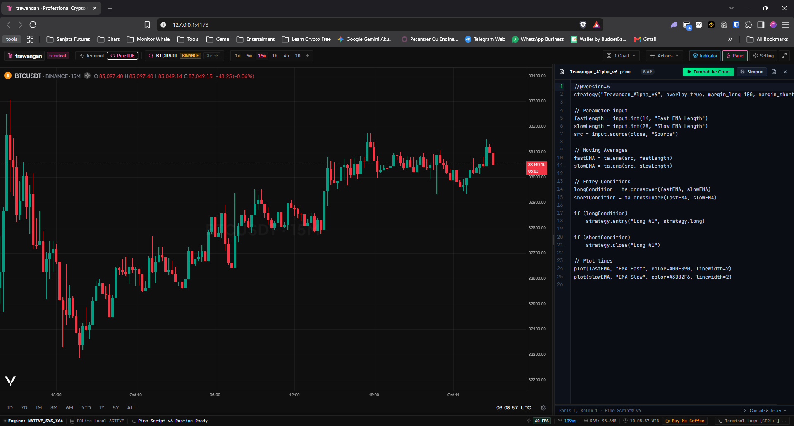
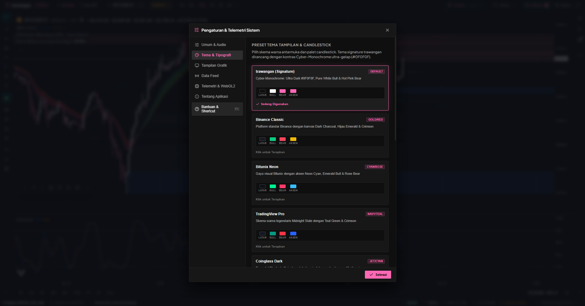

<p align="center">
  
</p>

# ꦠꦿꦮꦔꦤ꧀ · trawangan

> **Professional Desktop Crypto Charting Terminal — Zero Paywall**  
> Ditenagai oleh **Tauri v2 (Rust Core)**, **Svelte 5 (Runes)**, **LuxAlgo Vela (WebGL2 Engine 120 FPS)**, dan **PineTS v6**.

<p align="center">
  <a href="https://github.com/KaleksananBarqi/trawangan/releases/latest"></a>
  <a href="https://v2.tauri.app/"></a>
  <a href="https://www.rust-lang.org/"></a>
  <a href="https://svelte.dev/"></a>
  <a href="https://www.khronos.org/webgl/"></a>
  
  
  <a href="LICENSE"></a>
</p>

<p align="center">
  🌐 <strong>Landing Page Resmi:</strong> <a href="https://kaleksananbarqi.github.io/trawangan/">https://kaleksananbarqi.github.io/trawangan/</a>
</p>

---

## 🔮 Filosofi & Makna Mendalam

Diambil dari etimologi bahasa Jawa **penerawangan** (ꦠꦿꦮꦔꦤ꧀ — *kemampuan batiniah untuk melihat menembus kabut manipulasi, ilusi kasat mata, dan kekacauan duniawi*). 

Di tengah ekosistem pasar kripto modern yang bising dan sarat distorsi likuidasi—di mana pergerakan harga acap kali dimanipulasi dan platform charting komersial mengunci alat analisis dasar di balik biaya langganan bulanan—**trawangan** dirancang untuk mengembalikan kedaulatan visual kepada trader. Memberikan visualisasi data yang objektif, presisi tinggi, dan tajam tanpa batasan *paywall*.

> [!IMPORTANT]
> **Batasan Ruang Lingkup (Pure Charting Scope):**  
> `trawangan` berfokus murni pada visualisasi charting grafis performa tinggi, orderflow, indikator teknikal kustom, dan pengujian strategi Pine Script v6. Aplikasi ini **secara sengaja tidak menyediakan fitur eksekusi order trading langsung** maupun integrasi dompet/brokerage modal nyata demi menjaga kemurnian analisis tanpa distraksi psikologis eksekusi.

---

## ⚖️ Komparasi Fitur: Zero-Paywall Parity

Mengapa harus membayar langganan bulanan mahal hanya untuk memasang indikator, menggambar setup, dan menguji strategi?

| Fitur / Kapabilitas | `trawangan` (Desktop Native) | Platform Komersial Gratis (TradingView dkk) |
| :--- | :---: | :---: |
| **Indikator Simultan** | **Tanpa Batas (Unlimited)** | Terbatas (Maksimal 2 - 3 indikator) |
| **Tools Gambar Teknikal** | **76+ Varian Lengkap + Gesture Inking** | Dibatasi / Berbayar |
| **Gesture Drawing Engine** | **Natural Inking (`Shift+D`), Scribble Erase** | Tidak Tersedia |
| **Multi-Chart Grid Layout** | **Bebas Penuh (1, 2, 2H, 4 Sel Sinkron)** | Terkunci di tier Pro/Premium ($14.95 - $59.95/bln) |
| **Kapasitas Watchlist** | **Multi-Watchlist Registry (Tanpa Kuota)** | Dibatasi kuota ketat (maks. 30 simbol) |
| **Eksekusi Pine Script v6** | **Penuh (PineTS Web Worker Lokal)** | Dibatasi server rate-limit & paywall |
| **Trading Plan Ingestion** | **Deterministik Sub-5ms (`Ctrl+Shift+P` / `Ctrl+V`)** | Wajib input posisi manual satu per satu |
| **Kalkulasi R Dinamis** | **Auto-Calculated R-Multiple pada TP1/TP2/SL** | Kalkulasi manual / statis |
| **Ekspor Tangkapan Layar** | **Ultra HD hingga 6x (~11.5K) + Side-by-Side Panel** | Resolusi standar / Terbatas |
| **Atribusi & Watermark** | **Profil Trader Offline & Anti-Theft Watermark** | Terkunci / Watermark platform bawaan |
| **Sistem Tema & Palet** | **Dual-Theme Decoupling + Studio "Save As" (9D)** | Terbatas pada tema bawaan gelap/terang |
| **Background Alert Engine** | **Multi-Koin Latar Belakang + Audio Chime** | Dibatasi kuota ketat (maks. 5 alert) |
| **Pintasan Institusional** | **Lengkap (`Alt+O`, `Ctrl+D`, `Alt+Z`, `Ctrl+Del`)** | Terbatas |
| **Data Feed Multi-Exchange** | **Real-time WebSocket Langsung (Binance, Indodax, dll)** | Sering tertunda (*delayed*) / berbayar |
| **Penyimpanan & Privasi** | **100% Offline Lokal (SQLite Rust `rusqlite`)** | Pelacak cloud, telemetri, & iklan |
| **Beban Memori (RAM)** | **Ultra-Ringan (~30-50 MB Tauri v2)** | Boros RAM (500 MB - 1.5 GB Electron) |
| **Biaya Langganan** | **Rp 0 / $0 Selamanya (Lisensi MIT)** | $179 - $719 / tahun |

---

## 🚀 Fitur Unggulan Generasi Baru (v0.16 – v0.32)

### 1. 🎨 Dual-Theme Decoupling & User Presets Studio (v0.32.0 — ADR 0017)
- **Pemisahan Independen App vs Canvas Theme:** Tentukan tema antarmuka aplikasi (`appThemePreset`) dan tema kanvas grafik (`chartThemePreset`) secara terpisah. Anda dapat menggunakan UI shell gelap futuristik dipadu kanvas koran terang jurnalisme keuangan (*Red Folder News*).
- **Studio Preset Tema Pengguna ("Save As"):** Simpan racikan palet warna kustom menjadi preset tersendiri dengan label `[CUSTOM]`, ganti nama, ekspor/impor ke berkas JSON atau teks papan klip instan.
- **System Theme Bridge & Header Switcher 1-Klik:** Sinkronisasi cerdas dengan preferensi mode gelap/terang sistem operasi (`window.matchMedia`) serta tombol pengubah cepat di bilah Header (*Moon, Sun, Monitor*).

### 2. 🔔 Background Alert Engine & Dynamic Market Feed (v0.32.0 — ADR 0017)
- **Evaluasi Level Harga di Latar Belakang:** Alert harga tetap aktif dievaluasi dan memicu suara kristal *Audio Chime* serta notifikasi native desktop, bahkan saat instrumen/koin bersangkutan tidak sedang dibuka di grafik aktif.
- **Dynamic Feed Ingestion:** Simbol alert otomatis disuntikkan ke dalam siklus data feed tanpa penghentian (*resume from idle*), menjamin eksekusi rencana trading selalu siaga.

### 3. 📰 Unified Theme Engine & Matriks Palet Penuh 9-Dimensi (v0.31.0 — ADR 0016)
- **Matriks Palet 9 Dimensi:** Konfigurasi independen 6 elemen lilin individual (`bullBody`, `bullWick`, `bullBorder`, `bearBody`, `bearWick`, `bearBorder`) dan 3 warna bidang utama (`background`, `container`, `textColor`).
- **Preset Resmi "Red Folder News":** Tema terang (*Light Mode*) terinspirasi jurnalisme Wall Street dengan latar krem koran (`#edede9`), tipografi burgundy (`#4A0E0F`), lilin bullish rose (`#D4A5A5`), dan lilin bearish crimson (`#9B1D20`).
- **Propagasi Tema Lintas Subsistem:** Token warna mengalir secara reaktif ke WebGL2 Vela, dialog internal Vela (@zag-js/dialog), menu konteks semantik, dan CodeMirror 6 Pine Editor (via ekstensi `Compartment`).

### 4. ⚡ Suite Pintasan Institusional & Auto-Fit Viewport (v0.30.0 — ADR 0005)
- **Smart-Toggle Object Tree (`Alt + O`):** Buka dan tutup bilah daftar objek gambar dan indikator secara instan tanpa memutus fokus kerja pada grafik lilin.
- **Mesin Duplikasi Objek Gambar (`Ctrl + D`):** Menggandakan objek gambar terpilih (garis tren, kotak FVG, Fibonacci) dengan pergeseran spasial adaptif cerdas (5 tick harga aktual dan 60s waktu), mendukung transaksi Undo/Redo atomik.
- **Bulk Toggle Visibilitas & Kunci (`Alt + K` & `Alt + L`):** Sembunyikan/tampilkan atau kunci/buka kunci seluruh gambar teknikal di kanvas secara serentak.
- **Hapus Seluruh Objek Sekaligus (`Ctrl + Delete`):** Pembersihan cepat seluruh gambar teknikal dengan konfirmasi aman.
- **Auto-Fit Viewport (`Alt + Z` / `F` / Double-Click Axis):** Menyesuaikan framing grafik dan seluruh candle historis ke viewport layar seketika.
- **Pembalikan Sumbu Skala Harga (`Alt + I`):** Balik orientasi harga secara vertikal (*invert price scale*) untuk memvalidasi bias setup dari sudut pandang berlawanan.

### 5. 📸 Side-by-Side Snapshot Layout & Dedicated Thesis Side Panel (v0.29.0)
- **Pemisahan Kanvas Bersih (Clean Chart Separation):** Kartu tesis analisis dipindahkan ke panel samping khusus (*Dedicated 2D Thesis Side Panel* ~380px), memastikan lilin candlestick, zona likuiditas SMC, dan indikator teknikal 100% terlihat jelas tanpa tertutup kartu.
- **Dedicated Thesis Side Panel:** Panel samping berstandar editorial finansial modern memuat lencana bias (*Bullish/Bearish*), harga entry, katalis multi-timeframe, blok narasi berformat epistemik (`[FAKTA]`, `[INFERENSI]`, `[SPEKULASI]`), batas invalidasi Stop Loss dengan badge risiko (`-1.00R`), serta target likuiditas bertingkat dengan proyeksi keuntungan `+R`.
- **Unified Attribution Bar:** Bingkai Branded Frame menyatukan grafik candlestick dan panel tesis ke dalam satu kesatuan estetis dengan proteksi tanda air (*Security Watermark*) yang terisolasi aman pada kanvas grafik.

### 6. 🎯 Kalkulasi & Visualisasi R Dinamis pada TP1, TP2, dan SL (v0.27.0 – v0.28.0)
- **Dynamic R-Multiple Price Scale Badges:** Menghitung rasio risk/reward aktual secara real-time langsung dari koordinat harga anchor: `TP1 (+X.XXR)`, `TP2 (+X.XXR)`, `SL (-1.00R)`.
- **Sinkronisasi Dua Arah (Bidirectional Sync):** Menyeret titik anchor Entry, Stop Loss, atau Take Profit di kanvas grafik otomatis memperbarui kalkulasi nilai R dan menyinkronkan seluruh kotak posisi bertingkat saudara (*sibling staged positions*).

### 7. 🛡️ Ultra HD Snapshots, Profil Trader & Watermark Anti-Maling (v0.26.0 — ADR 0015)
- **Kompositor Multi-Skala Ekstrim (1x, 2x HiDPI, 4x Ultra HD, 6x Super HD):** Ekspor resolusi tinggi hingga ~11520x6480 piksel tanpa kehilangan ketajaman tipografi maupun wick lilin.
- **Trader Profile Attribution (100% Offline):** Sematkan identitas trader (Avatar lokal Base64, username, bio, dan handle media sosial) pada Attribution Bar tangkapan layar.
- **Tanda Air Keamanan Anti-Maling (Anti-Theft Security Watermark):** Watermark teks diagonal semi-transparan (-32°) yang melindungi karya analisis teknikal Anda dari pembajakan/reupload konten di media sosial.
- **Latar Kanvas Kustom:** Pilih antara tema preset bawaan, warna heksadesimal solid, atau gradien vertikal mewah dua warna.

### 8. 📋 Penerimaan Rencana Perdagangan Deterministik (v0.26.0 — ADR 0014)
- **Zero-LLM & Zero-OCR Local Parser (< 5ms):** Ekstraksi parameter posisi trading (`Bias`, `Entry`, `Stop Loss`, `TP1..TPn`, zona FVG) dari tabel Markdown atau teks mentah secara instan.
- **Smart Canvas Paste (`Ctrl + V`) & Akses Global (`Ctrl + Shift + P`):** Cukup salin teks setup trading dari AI atau jurnal, lalu tekan tempel di grafik untuk langsung menggambar kotak posisi bertingkat (*staged position boxes*) secara otomatis.
- **Sanity Guard & Tick-Aligned Price Guard:** Validasi matematis otomatis arah posisi dan pembulatan ke tick size bursa aktif.

### 9. ✍️ Draw by Holding Gesture Engine (v0.25.0 — ADR 0013)
- **Natural Inking via Shortcut Hold (`Shift+D` atau `~`):** Tahan tombol dan goreskan mouse bebas di grafik untuk melahirkan alat gambar secara alami.
- **Pengenalan Pola Cerdas (Gesture Recognizer):** Deteksi otomatis garis tren (*Trend Line*), *Horizontal Ray*, *Vertical Line*, kotak (*Rectangle*), elips (*Ellipse*), *Fib Retracement*, panah (*Arrow*), dan *Path*.
- **Scribble to Erase:** Coretan zig-zag di atas gambar langsung menghapusnya seketika dengan dukungan Undo penuh (`Ctrl+Z`).
- **Siklus Kandidat Interaktif (`Tab`) & Cheatsheet Visual:** Tekan `Tab` untuk memilih variasi alat alternatif dan buka katalog visual cheatsheet dari toolbar.
- **Timeframe Quick Input Bar:** Tekan angka apa saja (`1`, `5`, `15`, `60`, `240`) untuk membuka bilah pencarian timeframe super-cepat.

### 10. 🌐 Jam Sesi Bursa Dunia di StatusBar & Multi-Exchange Feed (v0.21.0 – v0.22.0)
- **World Market Session Clocks:** Jam dunia terintegrasi di StatusBar (Tokyo, London, New York, WIB/Jakarta, UTC) untuk memantau waktu pembukaan likuiditas sesi global.
- **Hybrid Symbol Logo Engine:** Ikon logo bursa/koin dinamis dengan fallback monogram geometris elegan.
- **Data Feed Komprehensif:** Dukungan native untuk Binance Spot & Futures, Indodax IDR (dengan format mata uang Rupiah asli `Rp 1.480.000.000`), Bitunix, Hyperliquid, dan Coinbase.

---

## 📸 Galeri Tampilan Antarmuka

### 1. Terminal Charting Utama & Vela WebGL2 Engine (120 FPS)
Rendering candlestick mulus hingga 120 FPS dengan akselerasi hardware penuh, orderflow real-time, mode navigasi geser Hand-Pull (<kbd>H</kbd>), penghapus interaktif 1-klik, dan panel status responsif.

<p align="center">
  
</p>

### 2. Side-by-Side Pine Script v6 Editor & Web Worker Scripting
Tulis, edit, dan kompilasi skrip PineTS v6 secara mandiri berdampingan dengan grafik menggunakan editor modern CodeMirror 6 tanpa membebani UI thread utama.

<p align="center">
  
</p>

### 3. Pengaturan Terminal, Audio Chime Alerts & Multi-Provider Data Feed
Kustomisasi zona waktu chart reaktif (WIB/Jakarta, UTC), nada alert kristal sintetis Audio Chime, notifikasi native Windows Toast, manajemen data feed multi-exchange (Binance, Indodax IDR, Bitunix, Hyperliquid, Coinbase), serta telemetri hardware WebGL2 real-time.

<p align="center">
  
</p>

### 4. Preset Multi-Tema WebGL2 & Kustomisasi Candlestick Hibrida
Harmonisasi palet warna tema instan (Signature Cyber-Monochrome `#0F0F0F` + `#FF69B4`, Red Folder News, Binance Classic, Bitunix Neon, TradingView Pro, Coinglass Dark) ke seluruh sel kanvas WebGL2, studio preset pengguna dengan fitur *Save As*, serta integrasi System Theme Bridge.

<p align="center">
  
</p>

---

## ⌨️ Cheatsheet Pintasan Keyboard Institusional

Trawangan dirancang dengan orientasi keyboard penuh (*Keyboard-First Workflow*) untuk kecepatan eksekusi analisis tanpa ketergantungan mouse:

| Pintasan Keyboard | Aksi & Fungsi Terminal |
| :--- | :--- |
| <kbd>Shift + D</kbd> atau <kbd>~</kbd> | **Draw by Holding Gesture Inking:** Tahan pintasan dan goreskan mouse untuk menggambar bentuk teknikal secara instan. |
| <kbd>Ctrl + Shift + P</kbd> | **Import Trading Plan Modal:** Buka dialog penerimaan rencana trading deterministik. |
| <kbd>Ctrl + V</kbd> (pada Kanvas) | **Smart Canvas Paste:** Tempelkan teks analisis/tabel trading plan langsung ke atas grafik. |
| <kbd>Ctrl + Shift + S</kbd> | **Quick Snapshot Clipboard:** Salin tangkapan layar Ultra HD berbingkai Branded Frame ke clipboard dalam hitungan milidetik. |
| <kbd>Alt + O</kbd> | **Toggle Object Tree & Indikator:** Buka/tutup bilah panel samping pengelola objek dan indikator teknikal. |
| <kbd>Ctrl + D</kbd> | **Duplicate Selected Drawing:** Gandakan objek gambar terpilih dengan offset spasial adaptif cerdas (5 tick & 60s). |
| <kbd>Alt + Z</kbd> atau <kbd>F</kbd> | **Auto-Fit Viewport:** Reset dan selaraskan skala harga serta waktu ke seluruh candlestick historis di layar. |
| <kbd>Alt + I</kbd> | **Invert Price Scale:** Balik orientasi sumbu harga vertikal secara terbalik. |
| <kbd>Alt + K</kbd> | **Bulk Toggle Visibility:** Sembunyikan atau tampilkan seluruh gambar teknikal di kanvas. |
| <kbd>Alt + L</kbd> | **Bulk Toggle Lock:** Kunci atau buka kunci seluruh gambar teknikal di kanvas. |
| <kbd>Ctrl + Delete</kbd> | **Clear All Drawings:** Bersihkan seluruh gambar teknikal pada grafik aktif secara serentak. |
| <kbd>Ctrl + K</kbd> atau Ketik Huruf | **Type-to-Search Sub-5ms:** Buka pencarian instrumen dan koin kripto multi-bursa. |
| Ketik Angka (<kbd>1</kbd>, <kbd>5</kbd>, <kbd>15</kbd>...) | **Timeframe Quick Input Bar:** Buka popover penggantian timeframe grafik secara kilat. |
| <kbd>H</kbd> atau <kbd>Spacebar</kbd> | **Hand-Pull Navigation:** Masuk ke mode tangan geser grafik tanpa mengklik tombol mouse. |
| <kbd>Del</kbd> / <kbd>Backspace</kbd> | **Delete Selected Drawing:** Hapus objek gambar yang sedang aktif/dipilih. |
| <kbd>Ctrl + Z</kbd> / <kbd>Ctrl + Y</kbd> | **Atomic Undo / Redo:** Batalkan atau ulangi aksi manipulasi gambar di kanvas. |
| <kbd>F1</kbd> atau <kbd>?</kbd> | **Keyboard Shortcuts Cheatsheet:** Tampilkan dialog glosarium seluruh pintasan terminal. |

---

## 🎨 Identitas Visual & Tema Signature
* **Kanvas Background:** `#0F0F0F` (True dark minimalis)
* **Garis Grid:** Redup halus monokrom `rgba(255, 255, 255, 0.05)`
* **Candlestick Bullish:** Serba putih gading `#F7F7F7` (badan, garis batas, dan sumbu)
* **Candlestick Bearish:** Hot pink `#FF69B4` (badan & sumbu) dan `#CC5A7F` (garis batas)
* **Brand Monogram:** `tr` hot pink dengan tipografi utama **Plus Jakarta Sans Extra Bold (800)**
* **Preset Alternatif:** Tersedia tema exchange di Pengaturan (`Red Folder News`, `Binance Classic`, `Bitunix Neon`, `TradingView Pro`, `Coinglass Dark`, serta palet kustom tanpa batas).

---

## 🛠️ Tech Stack Modern

- **Desktop Framework:** [Tauri v2](https://v2.tauri.app/) (Rust Core)
- **Frontend Framework:** [Svelte 5](https://svelte.dev/) (Runes) + SvelteKit SPA (adapter-static)
- **Bundler & Tooling:** [Vite](https://vitejs.dev/) + TypeScript
- **Chart Renderer:** [@luxalgo/vela](https://github.com/luxalgo/vela) (WebGL2 120 FPS Engine)
- **Scripting Engine:** [@luxalgo/vela-pinets](https://github.com/luxalgo/vela) + [PineTS](https://github.com/luxalgo/pinets)
- **Code Editor:** [CodeMirror 6](https://codemirror.net/) (Pine Editor dengan Reactive Compartments)
- **Database:** SQLite (Embedded Rust via `rusqlite`)
- **Icons:** [Lucide Svelte](https://lucide.dev/)

---

## 💻 Pengembangan Lokal (Local Development)

### Prasyarat
- [Node.js](https://nodejs.org/) (v20+)
- [Rust & Cargo](https://rustup.rs/) (stable)
- **Windows:** C++ Build Tools & WebView2 (sudah terinstal secara default pada Windows 10/11)
- **Linux:** `libwebkit2gtk-4.1-dev`, `build-essential`, `curl`, `wget`, `file`, `libssl-dev`, `libayatana-appindicator3-dev`, `librsvg2-dev`
- **macOS:** Xcode Command Line Tools

### Menjalankan Mode Dev
```bash
# 1. Clone repositori
git clone https://github.com/KaleksananBarqi/trawangan.git
cd trawangan

# 2. Install dependensi frontend
npm install

# 3. Jalankan aplikasi desktop dengan hot-reload
npm run tauri dev
```

---

## 📦 Build Release Multi-Platform

### 1. Build Lokal
Untuk membuat installer lokal pada sistem operasi Anda:
```bash
npm run tauri build
```
Output installer (`.exe` NSIS installer & `.msi` di Windows, `.AppImage` & `.deb` di Linux, `.dmg` di macOS) akan berada di direktori:
`src-tauri/target/release/bundle/`

### 2. Build Multi-Platform Otomatis (CI/CD via GitHub Actions)
Aplikasi ini sudah dilengkapi dengan GitHub Actions CI/CD matrix workflow (`.github/workflows/release.yml`) untuk mem-build binary release secara otomatis di ketiga platform:

#### Cara Trigger Release Otomatis:
1. **Lewat Git Tag (Direkomendasikan):**
   ```bash
   git tag -a v0.32.0 -m "Release v0.32.0"
   git push origin v0.32.0
   ```
2. **Lewat GitHub CLI:**
   ```bash
   gh workflow run release.yml -f tag=v0.32.0
   ```
3. **Lewat GitHub Actions UI:**
   Buka tab **Actions** di GitHub -> Pilih **release trawangan** -> Klik **Run workflow** -> Masukkan versi tag (contoh `v0.32.0`).

### Hasil Paket Rilis Biner:
- **Windows:** `.exe` (NSIS Setup) & `.msi`
- **Linux:** `.deb` (Debian/Ubuntu) & `.AppImage` (Universal Linux)
- **macOS:** `.dmg` & `.app` (Apple Silicon & Intel)

---

## 📚 Keputusan Arsitektur & Spesifikasi (ADR)

Seluruh arsitektur, filosofi, dan pagar pembatas performa Trawangan didokumentasikan dalam Architecture Decision Records (ADR):
- [ADR 0001: Brand Identity, Signature Theme, and Pure Charting Scope](docs/adr/0001-brand-identity-and-theming-system.md)
- [ADR 0002: Distribution Strategy and Self-Contained Landing Page Architecture](docs/adr/0002-distribution-and-landing-page-strategy.md)
- [ADR 0003: Core Architecture and Lightweight Guardrails Specification](docs/adr/0003-core-architecture-and-lightweight-guardrails.md)
- [ADR 0004: Docked Structural Shell Architecture](docs/adr/0004-docked-structural-shell-architecture.md)
- [ADR 0005: Workspace Layout and Indicator State Management](docs/adr/0005-workspace-layout-and-indicator-state-management.md)
- [ADR 0006: Exchange-Aware Drawings and Multi-Provider Watchlist](docs/adr/0006-exchange-aware-drawings-and-multi-provider-watchlist.md)
- [ADR 0012: Offline Branded Snapshot Engine and Attribution Frame](docs/adr/0012-offline-branded-snapshot-engine-and-attribution-frame.md)
- [ADR 0013: Draw by Holding Gesture Engine and Shortcut Revamp](docs/adr/0013-draw-by-holding-gesture-engine-and-shortcut-revamp.md)
- [ADR 0014: Deterministic Trading Plan Ingestion and Multi-Target Positions](docs/adr/0014-deterministic-trading-plan-ingestion-and-multi-target-positions.md)
- [ADR 0015: Trader Profile, Security Watermark, and Custom Canvas Background](docs/adr/0015-trader-profile-security-watermark-and-custom-canvas-background.md)
- [ADR 0016: Unified Theme Engine, Full Palette Matrix, and Cross-Subsystem Propagation](docs/adr/0016-unified-theme-engine-full-palette-matrix-and-cross-subsystem-propagation.md)
- [ADR 0017: Dual-Theme Decoupling, User Theme Presets, and Background Alert Engine](docs/adr/0017-dual-theme-decoupling-user-theme-presets-and-background-alert-engine.md)

---

## 📄 Lisensi
Didistribusikan di bawah lisensi terbuka **MIT License**. Lihat [LICENSE](LICENSE) untuk detail lengkap.
