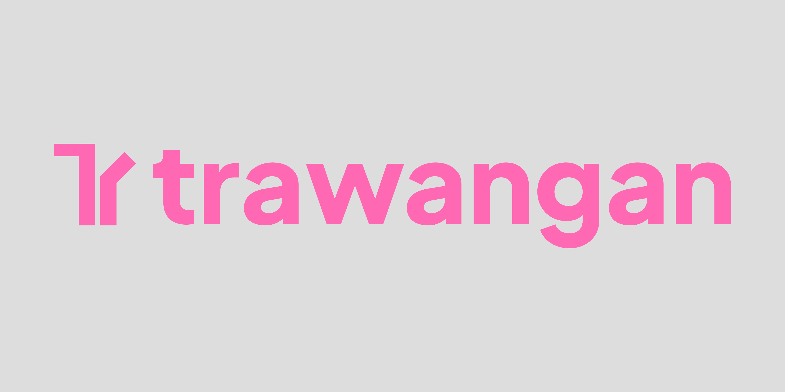
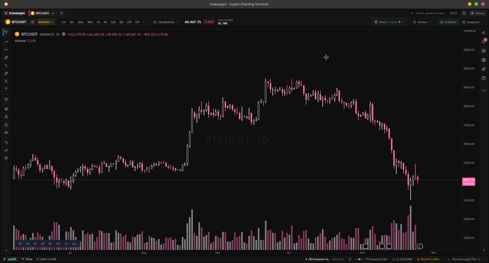
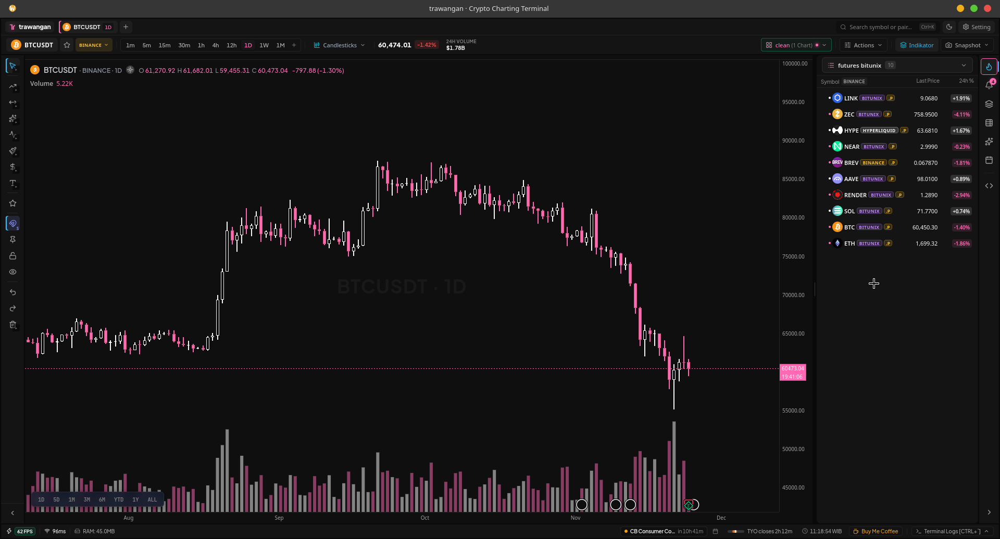
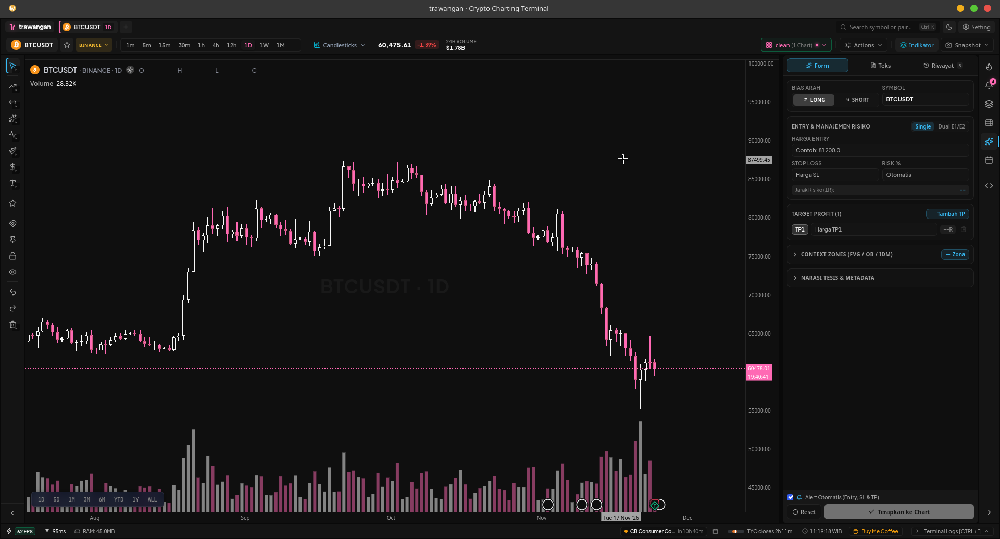
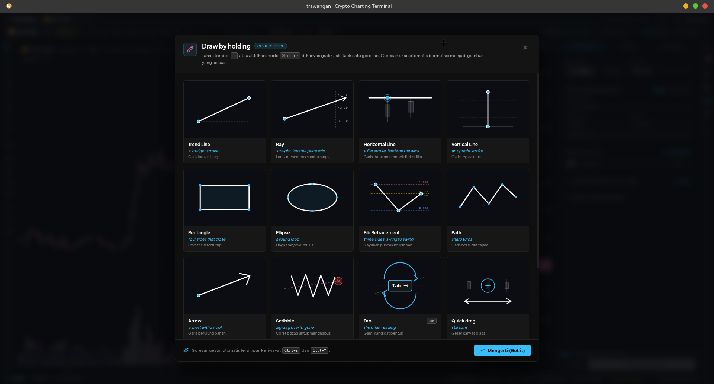
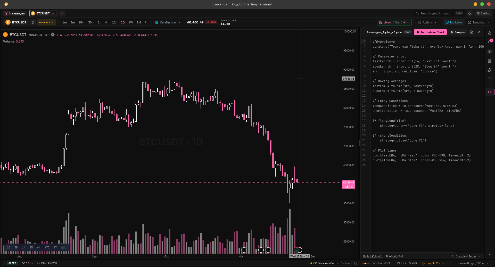
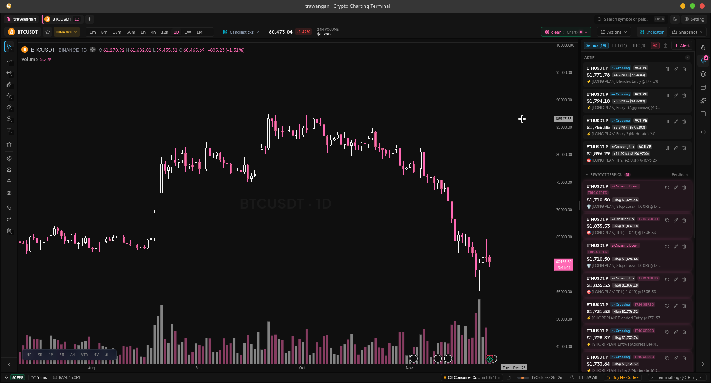
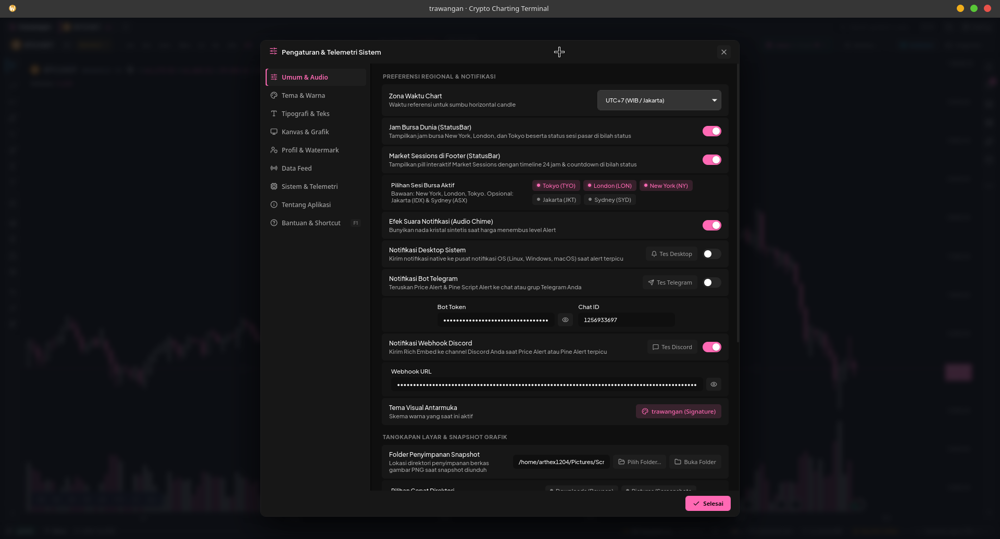
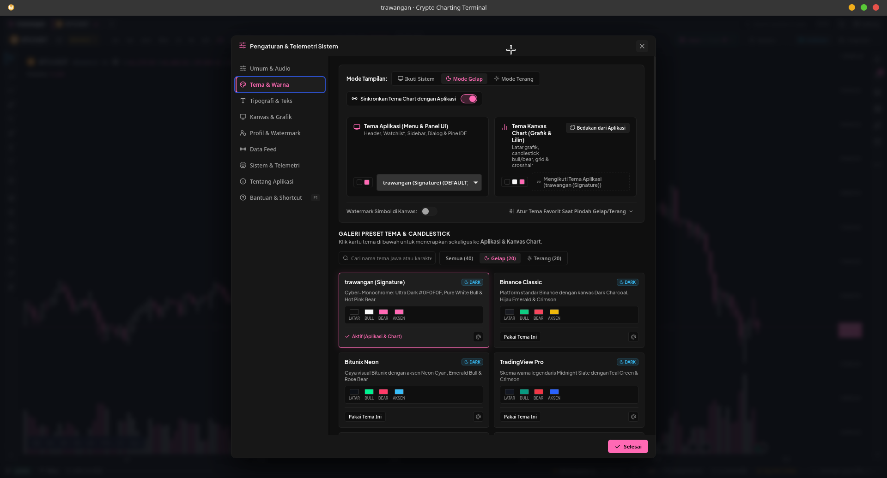

<p align="center">
  
</p>

<p align="center">
  <strong>🌐 Pilih Basa / Language:</strong>
  &nbsp;🔥 <strong>Basa Jawa Arekan (Default)</strong>&nbsp; ·
  &nbsp;<a href="README.id.md">🇮🇩 Bahasa Indonesia</a>&nbsp; ·
  &nbsp;<a href="README.en.md">🇬🇧 English</a>
</p>

# ꦠꦿꦮꦔꦤ꧀ · trawangan

> **Terminal Charting Desktop Multi-Aset & Kripto, Gratis Pol Selawase (Zero Paywall)**  
> Dibangun nganggo **Tauri v2 (Rust Core)**, **Svelte 5 (Runes)**, **LuxAlgo Vela (WebGL2 Engine 120 FPS)**, lan **PineTS v6**.

<p align="center">
  <a href="https://github.com/KaleksananBarqi/trawangan/releases/latest"></a>
  <a href="https://v2.tauri.app/"></a>
  <a href="https://www.rust-lang.org/"></a>
  <a href="https://svelte.dev/"></a>
  <a href="https://www.khronos.org/webgl/"></a>
  
  <a href="LICENSE"></a>
</p>

<p align="center">
  <strong>Landing Page Resmi:</strong> <a href="https://kaleksananbarqi.github.io/trawangan/">https://kaleksananbarqi.github.io/trawangan/</a>
</p>

---

## Filosofi & Karakter `trawangan`

Jeneng **trawangan** asale teko kosakata Jawa *penerawangan* (ꦠꦿꦮꦔꦤ꧀), mata sing tajem nembus kabut ilusi, manipulasi bandar, lan rame-rame sing gak mutu nang market.

Nang tengah-tengah platform charting komersial sing matok sewa wulanan larang mek gawe nambah indikator utawa mbukak multi-chart, **trawangan** mbalikno kendali meja analisa 100% nang tanganmu, Rek! Kabeh grafik WebGL2 120 FPS, indikator Pine Script v6 tanpa wates kuota, multi-watchlist, indeks makro (`TOTAL`, `BTC.D`), saham IDX (`BBCA.JK`), emas COMEX (`GC=F` / `XAUUSD`), sampek **Trade Plan Vault** mlaku lokal nang laptop/PC-mu tanpa paywall blas!

> [!IMPORTANT]
> **Charting Murni Default + Opt-In Execution Bridge (`ADR-0031`):**  
> Secara default, `trawangan` mlaku murni gawe charting & riset ben koen gak kakehan FOMO pencet Buy/Sell ngawur, Cok! **TAPI** nek koen wis siap tempur, saiki ono fitur **Opt-In Execution Bridge (100% Opsional, Default OFF)** gawe konek nang **1. Binance**, **2. Bitunix**, lan **3. Broker CFD / MetaTrader 5 (MT5)** lewat gerbang keamanan 3 tahap. Eksekusi order dipisah tegas teko Trade Plan lan wajib koen input **MANUAL** liwat tab **Order**.

---

## Adu Mekanik: Zero-Paywall Parity

Kabeh fitur cadas iki langsung kebukak gratis pol tanpa tier Pro/Premium abal-abal:

| Fitur / Kapabilitas | `trawangan` (Desktop Native) | Platform Komersial Gratisan |
| :--- | :---: | :---: |
| **Indikator Simultan** | **Sak karepmu tanpa wates kuota!** | Dibatasi pelit (2 - 3 indikator tok) |
| **Alat Gambar Teknikal** | **76 varian komplit + Gesture Inking multi-pane** | Sebagian dikunci nang paket bayar |
| **Gesture Drawing Engine** | **Draw by Holding (`Shift+D` / `~`) & Scribble Erase** | Gak ono blas |
| **Multi-Chart Grid Layout** | **Bebas pol (1, 2, 2H, 4 sel) + kloning `Save As`** | Dikunci langganan wulanan |
| **Manajemen Trading Plan** | **Tab `Plan` (`Preview` \| `Form` \| `Teks` \| `Riwayat`), Dual-Entry & Edit In-Place** | Nggaris kotak & ngitung R manual kesuwen |
| **Docked Thesis Preview** | **Rapi nang jero Tab `Plan` (Chart resik gak ketutupan overlay!)** | Gak ono |
| **Opt-In Execution Bridge** | **Opsional (Default OFF): Binance, Bitunix & Local MT5 CFD + Tutorial Komplit** | Terikat broker afiliasi tertentu |
| **Tutorial Start-Up & Multi-Basa** | **Spotlight Tour Interaktif + 3 Basa (`Jawa Arekan Default`, `ID`, `EN`)** | Statis |
| **Eksekusi Pine Script v6** | **CodeMirror 6 Side-by-Side + Web Worker PineTS lokal** | Antri server cloud |
| **Ekspor Snapshot Gambar** | **Ultra HD 2x - 6x + Dedicated Thesis Side Panel** | Resolusi standar 1x burem |
| **Sistem Tema & Kontras** | **37 preset resmi (31 tema Jawa + Warta Abang) & Studio 9D** | Tema standar tok |
| **Cakupan Pasar & Makro** | **Binance, Indodax IDR, Bitunix, Hyperliquid, Coinbase, Yahoo Finance (IDX, COMEX, US), & Makro (`TOTAL` 1-3, `OTHERS`, `BTC.D`)** | Data ekstra kudu mbayar maneh |
| **Konsumsi Memori (RAM)** | **Entheng pol ~30 - 50 MB (Rust Native)** | 500 MB - 1.5 GB (Electron / Browser lemot) |
| **Biaya & Lisensi** | **Rp 0 / \$0 Selawase (Apache 2.0 + Wajib Kredit `NOTICE`)** | \$14.95 - \$59.95 / wulan |

---

## Kapabilitas Utama Cadas

### 1. Docked Thesis Preview nang Tab `Plan` & Dual-Entry (`ADR-0014` - `ADR-0032`)
Lali karo kartu tesis melayang sing nutupi candlestick! Saiki kabeh pratinjau kartu tesis pindah rapi nang sub-tab **`Preview`** nang jero tab **`Plan`** panel tengen (`Preview | Form | Teks | Riwayat`). Begitu koen ngetik plan nang `Form` utawa paste tabel Markdown (`Ctrl+V` -> `Ctrl+Enter`), sub-tab `Preview` langsung nampilno kartu tesis lengkap karo badge `[FAKTA]`, `[INFERENSI]`, `[SPEKULASI]`, bobot **Dual-Entry (`E1` & `E2` + `Blended Entry`)**, **POI Context Zones** (`FVG`, `OB`, `IDM`), lan jarak rega live. Pas diekspor snapshot (`Ctrl+Shift+S`), kartu tesis otomatis tampil nang **Side Panel** sebelah tengen chart!

### 2. Opt-In Execution Bridge: Binance, Bitunix, & MT5 CFD (`ADR-0031`)
Default-e **OFF total** (nol tombol Buy/Sell nang layar). Nek koen butuh eksekusi langsung teko terminal:
1. Bukak **Setelan → Broker & Eksekusi**, lewati gerbang persetujuan risiko mandiri.
2. Woco **Tutorial Setup Komplit** sing wis disediakno nang jero aplikasi gawe **Binance** (Spot/Futures `HMAC-SHA256`), **Bitunix** (Perpetual `SHA256`), utawa **Broker CFD / MetaTrader 5** (download 1-klik file EA resmi `TrawanganMT5Bridge.mq5` sing mlaku 100% gratis & lokal nang `127.0.0.1:15555`).
3. Klik **Tes Koneksi & Verifikasi**, terus nyalakno Master Switch. Tab **`Order` (`Manual Order Ticket`)** bakal muncul nang dock tengen, **terpisah tegas teko Trade Plan** ben saben order bener-bener koen ketik lan konfirmasi secara manual!

### 3. Startup Spotlight Tour & Lokalisasi 3 Basa (`Jawa Arekan Default`, `ID`, `EN`)
Pas pertama mbukak aplikasi, **Startup Spotlight Tour** langsung nuntun koen milih basa, tema werna, cara golek simbol (`Ctrl+K`), nggambar kilat *Draw by Holding* (`Shift+D` / `~`), sampek Pine IDE. Isok diputer maneh kapan wae teko tombol **Tutorial** nang Header! Ganti basa sak klik antarane **Basa Jawa Ngoko Arekan Cadas (Default)**, **Bahasa Indonesia**, lan **English**.

### 4. Data Multi-Aset Gratis & Crypto Macro Index (`ADR-0021` & `ADR-0024`)
- **Kripto Spot & Perp:** Binance, Indodax (IDR asli), Bitunix, Hyperliquid, Coinbase, plus Custom Node.
- **Crypto Macro Index Tanpa API Key:** Pantau `TOTAL`, `TOTAL2`, `TOTAL3`, `OTHERS`, `BTC.D`, `ETH.D`, lan `USDT.D` teko basket sintetis lokal kanthi kebijakan **Beban Latar Nol** (mek mlaku pas chart-e dibukak).
- **Saham IDX, Emas COMEX & Indeks AS:** Gratis lewat Yahoo Finance (`BBCA.JK`, `BBRI.JK`, `GC=F` / alias `XAUUSD` & `GOLD`, `^IXIC`) lengkap karo resampling `2H`/`4H` lan label jujur `DELAYED 15M`.

---

## Galeri Tampilan Nyata (8 Permukaan Kerja)

### 1. Terminal Charting Utama & WebGL2 Vela Engine
<p align="center">
  
</p>

### 2. Panel Watchlist Lintas Bursa & Multi-Watchlist
<p align="center">
  
</p>

### 3. Tab Trade Plan, Dual-Entry & Proyeksi Multi-Target
<p align="center">
  
</p>

### 4. Gesture Engine: Draw by Holding (`Shift+D` / `~`) & Scribble Erase
<p align="center">
  
</p>

### 5. Side-by-Side Pine Script v6 IDE (CodeMirror 6 + Web Worker)
<p align="center">
  
</p>

### 6. Manajemen Price Alert, Draggable Line & Background Engine
<p align="center">
  
</p>

### 7. Setelan Terminal, Basa, Audio Chime & Broker Bridge
<p align="center">
  
</p>

### 8. Dual-Theme Decoupling & 37 Preset Tema (31 Tema Jawa + Warta Abang)
<p align="center">
  
</p>

---

## Cheatsheet Pintasan Keyboard

| Pintasan Keyboard | Fungsi nang Terminal |
| :--- | :--- |
| <kbd>Ctrl + K</kbd> utawa Ketik Huruf | Bukak modal golek simbol (kripto, makro `TOTAL`/`BTC.D`, IDX, COMEX, US). |
| Ketik Angka (<kbd>1</kbd>, <kbd>15</kbd>, <kbd>240</kbd>...) | Ganti timeframe kilat langsung nang ndhuwur kanvas (`2H`/`4H` didukung). |
| <kbd>Shift + D</kbd> utawa tahan <kbd>~</kbd> | **Draw by Holding:** Goresno kursor dadi Trendline, Box, Fib; zig-zag gawe mbusek! |
| <kbd>Ctrl + Shift + P</kbd> | Bukak tab `Plan` nang panel tengen (`Preview`, `Form`, `Teks`, `Riwayat`). |
| <kbd>Ctrl + Enter</kbd> | Pasang trade plan anyar utawa simpen oprekan *in-place* nang tab `Plan`. |
| <kbd>Ctrl + V</kbd> (nang Kanvas) | Paste draf tabel Markdown trading plan langsung mlebu editor tab `Plan`. |
| <kbd>Ctrl + Shift + S</kbd> | Salin snapshot Ultra HD (sampek 6x) lengkap karo Thesis Side Panel. |
| <kbd>Alt + W</kbd> / <kbd>Alt + O</kbd> / <kbd>Alt + E</kbd> | Toggle **Watchlist** (`Alt+W`), **Object Tree** (`Alt+O`), utawa **Pine IDE** (`Alt+E`). |
| <kbd>Alt + A</kbd> | Gawe Price Alert kilat pas nang rega kursor saiki. |
| <kbd>Shift + R</kbd> | Mlebu/metu mode simulasi **Bar Replay** (`Space` play/pause). |
| <kbd>F1</kbd> / <kbd>?</kbd> | Bukak Pusat Pintasan Keyboard & Bantuan. |

---

## Oprek Lokal & Build Multi-Platform

```bash
git clone https://github.com/KaleksananBarqi/trawangan.git
cd trawangan
npm ci
npm run tauri dev
```

Gawe mbangun installer rilis native (`.exe` / `.msi` Windows, `.AppImage` / `.deb` / `.rpm` Linux, `.dmg` macOS):
```bash
npm run tauri build
```

*(Catetan Peta Jalan Mobile: Kelayakan kompilasi ke **iOS & Android** nganggo Tauri v2 Mobile + Adaptive Touch Shell wis didokumentasikno nang [ADR-0030](docs/adr/0030-tauri-v2-mobile-readiness-and-adaptive-touch-shell.md)).*

---

## Keputusan Arsitektur (ADR)

Kabeh putusan arsitektur lan desain domain `trawangan` kacatet lengkap nang folder `docs/adr/`:
- [ADR 0001: Brand Identity & Signature Theme](docs/adr/0001-brand-identity-and-theming-system.md) · [ADR 0002: Landing Page & Distribution](docs/adr/0002-distribution-and-landing-page-strategy.md) · [ADR 0003: Core Architecture Guardrails](docs/adr/0003-core-architecture-and-lightweight-guardrails.md) · [ADR 0004: Docked Structural Shell](docs/adr/0004-docked-structural-shell-and-side-by-side-ide.md) · [ADR 0007: Unified Object Tree](docs/adr/0007-unified-object-tree-and-browser-deep-link-bridge.md) · [ADR 0014: Deterministic Trading Plan](docs/adr/0014-deterministic-trading-plan-ingestion-and-multi-target-positions.md) · [ADR 0019: Thesis Surface & Trade Plan Vault](docs/adr/0019-chart-mode-preset-memory-chart-dominant-thesis-trade-plan-vault-and-auto-alerts.md) · [ADR 0021: Yahoo Finance Multi-Asset](docs/adr/0021-yahoo-finance-provider-and-dynamic-feeder-routing.md) · [ADR 0024: Crypto Macro Index](docs/adr/0024-crypto-macro-index-and-synthetic-basket-feeder.md) · [ADR 0030: Tauri v2 Mobile Readiness (iOS & Android)](docs/adr/0030-tauri-v2-mobile-readiness-and-adaptive-touch-shell.md) · [ADR 0031: Opt-In Execution Bridge & Manual Order Ticket](docs/adr/0031-opt-in-execution-bridge-and-decoupled-manual-order-ticket.md) · [ADR 0032: Docked Thesis Preview, Arekan i18n, Onboarding & Apache-2.0](docs/adr/0032-docked-thesis-preview-arekan-i18n-onboarding-and-apache2-license.md) · [ADR 0033: Upstream Engine & Asset Attribution Governance](docs/adr/0033-upstream-engine-and-asset-attribution-governance.md)

---

## Kredit, Atribusi Engine, Pustaka & Aset Open-Source

`trawangan` dibangun nganggo dedikasi teko akeh proyek open-source, kurator aset visual, pencipta huruf terbuka, lan penyedia data publik. Maturnuwun sak gedhe-gedhene gawe kabeh kreator lan kontributor ing ngisor iki:

### 1. Core Engines, Scripting & Runtime Native
| Komponen / Paket | Pembuat / Maintainer | Lisensi | Peran nang `trawangan` |
| :--- | :--- | :---: | :--- |
| **[Vela](https://velacharts.dev)** (`@luxalgo/vela`) | **LuxAlgo** ([GitHub](https://github.com/luxalgo/vela)) | `Apache-2.0 + NOTICE` | Kanvas charting WebGL2 120 FPS, multi-chart workspace, alat gambar teknikal, lan overlay native |
| **[PineTS](https://github.com/LuxAlgo/PineTS)** (`pinets`, `@luxalgo/vela-pinets`) | **LuxAlgo** ([Vela-PineTS](https://github.com/LuxAlgo/Vela-pinets)) | `AGPL-3.0-only` | Transpiler AST lan runtime Pine Script v6 sing mlaku nang Web Worker lokal |
| **[Acorn](https://github.com/acornjs/acorn)** & **[Astring](https://github.com/davidbonnet/astring)** | Marijn Haverbeke, Ingvar Stepanyan, David Bonnet | `MIT` | Parser AST JavaScript, walker, lan code generator pendukung PineTS |
| **[Tauri v2](https://v2.tauri.app/)** & Official Plugins | The Tauri Programme (Commons Conservancy) | `Apache-2.0 / MIT` | Host desktop native lintas OS super entheng (~45 MB RAM) tanpa Electron |
| **[Rust Core](https://www.rust-lang.org/)** & Crates (`tokio`, `reqwest`, `serde`, `sha2`, `chrono`, `rfd`) | The Rust Project Developers & Crate Authors | `MIT / Apache-2.0` | Runtime asinkron, koneksi HTTP/WebSocket langsung, enkripsi HMAC/SHA256, dialog OS |
| **[SQLite](https://sqlite.org/)** & **[Rusqlite](https://github.com/rusqlite/rusqlite)** | D. Richard Hipp & Rusqlite Developers | `Public Domain / MIT` | Database lokal 100% offline gawe cache candle, workspace, lan Trade Plan Vault |
| **[Svelte 5](https://svelte.dev/)**, **[SvelteKit](https://svelte.dev/docs/kit)** & **[Vite](https://vite.dev/)** | Rich Harris, Evan You & Contributors | `MIT` | UI compiler reaktif zero-VDOM berbasis Runes lan build toolchain |
| **[CodeMirror 6](https://codemirror.net/)** | Marijn Haverbeke & Contributors | `MIT` | Editor kode modular gawe Side-by-Side Pine Script v6 IDE |

### 2. Aset Visual, Ikonografi, Logo Multi-Aset & Tipografi
| Aset / Pustaka | Pembuat / Kurator | Lisensi | Cakupan nang `trawangan` |
| :--- | :--- | :---: | :--- |
| **[Lucide Icons](https://lucide.dev/)** (`@lucide/svelte`) | Lucide Contributors (fork Feather Icons) | `ISC / MIT` | Ikonografi antarmuka terminal, toolbar gambar, dock, lan modal setelan |
| **[Web3Icons](https://github.com/0xa3k5/web3icons)** (`@0xa3k5/web3icons`) | 0xa3k5 & Contributors | `MIT` | Ikon SVG koin & token kripto utama (`static/icons/coins/` + CDN) |
| **[Cryptocurrency Icons](https://github.com/spothq/cryptocurrency-icons)** | SpotHQ & Contributors | `MIT / CC0-1.0` | Ikon SVG token kripto cadangan tingkat loro |
| **[Circle Flags](https://github.com/HatScripts/circle-flags)** | HatScripts & Contributors | `MIT` | Bendera negara & mata uang fiat bundar (`static/icons/flags/`, `IDR`/`USD`/`EUR`) |
| **[Global Stock Logos](https://github.com/MrChartist/global-stock-logos)** | MrChartist | `Open Curated (Fair Use)` | Logo SVG perusahaan saham global & AS (`static/icons/stocks/`) |
| **[Ticker Logos](https://github.com/davidepalazzo/ticker-logos)**, **[NVSTly Icons](https://github.com/nvstly/icons)**, **[ShaadyEmad Ticker Logos](https://github.com/ShaadyEmad/ticker-logos)** & **IDX Issuer Favicons (`IDX_COMPANY_DOMAINS`)** | Davide Palazzo, NVSTly, Shaady Emad & Emiten IDX | `MIT / Open Curated / Fair Use` | Logo cadangan saham AS, ETF, koin kripto, lan favicon domain resmi emiten IDX |
| **[Plus Jakarta Sans](https://github.com/tokotype/PlusJakartaSans)** | Gumpita Rahayu / Tokotype | `OFL-1.1` | Huruf geometris wordmark lowercase `trawangan` lan antarmuka UI |
| **[JetBrains Mono](https://www.jetbrains.com/lp/mono/)** | JetBrains s.r.o. (Philipp Nurullin & Konstantin Bulenkov) | `OFL-1.1` | Huruf monospasi tabular gawe sumbu rega, R-multiple, telemetri, lan kode Pine |
| **Aset Orisinal `trawangan`** | Kaleksanan Barqi Aji Massani | `Apache-2.0` | Ikon komoditas (`GOLD`, `SILVER`, `OIL`, `NATGAS`, `COPPER`), ikon makro (`TOTAL`..`USDT.D`), logo monogram, 37 preset tema, & audio Web Audio API |

### 3. Sumber Data Pasar, Makro & Kalender Publik
- **Bursa Kripto (Direct REST/WebSocket):** Binance, Indodax, Bitunix, Hyperliquid, lan Coinbase Exchange.
- **Kalibrasi Indeks Makro Lokal (`Crypto Macro Index`):** [CoinGecko Public API](https://www.coingecko.com/) lan [DefiLlama Stablecoins API](https://defillama.com/).
- **Saham IDX, Komoditas COMEX & Indeks AS:** Yahoo Finance (`DELAYED 15M`).
- **Kalender Makroekonomi Mingguan:** Fair Economy / ForexFactory Public Calendar Feed.

> [!NOTE]
> **Sanggahan Merek Dagang (Nominative Fair Use):** Kabeh jeneng bursa, ticker saham, logo token kripto, lan logo perusahaan emiten (kalebu saham IDX lan AS) tetep dadi hak cipta lan merek dagang pemilik asline masing-masing, lan mung digawe kanggo identifikasi instrumen analisis.

---

## Lisensi & Atribusi Wajib (Apache 2.0 + `NOTICE`)

Proyek **trawangan** dirilis nang ngisore **Apache License, Version 2.0** (deloken berkas [LICENSE](LICENSE) lan [NOTICE](NOTICE)).

> [!WARNING]
> **ATURAN WAJIB KREDIT JELAS & KLIR (Klausul 4d Apache 2.0):**  
> Koen bebas nggawe, ngoprek, utawa nge-fork kode sumber iki, **TAPI WAJIB HUKUME** nyantumno kredit pembuat asli (**Kaleksanan Barqi Aji Massani, `https://github.com/KaleksananBarqi/trawangan`**) secara **JELAS lan KETOK MATA** nang jero berkas `NOTICE`, dokumentasi/README, lan nang tampilan menu **"Tentang Aplikasi / About"** nang aplikasi turunanmu. Ojok mbusek kredit wong sing rekoso mbangun teko nol, Cok!
