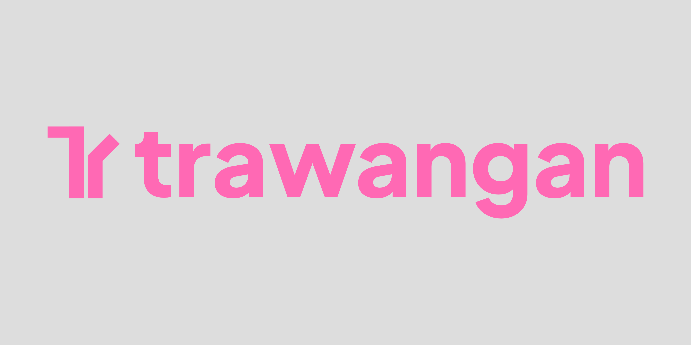
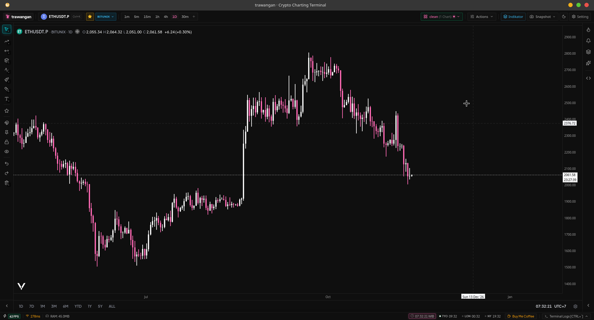
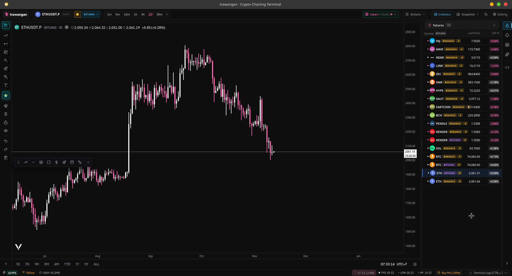
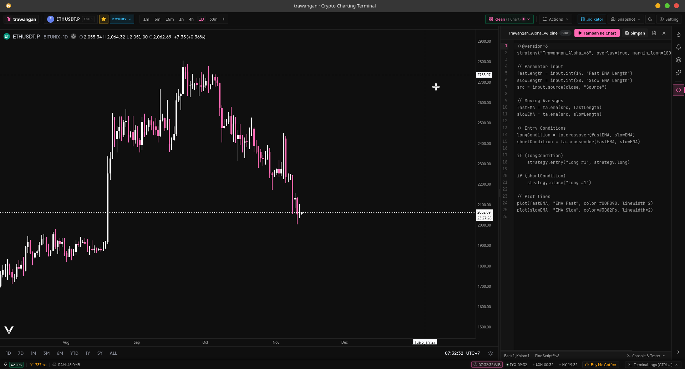
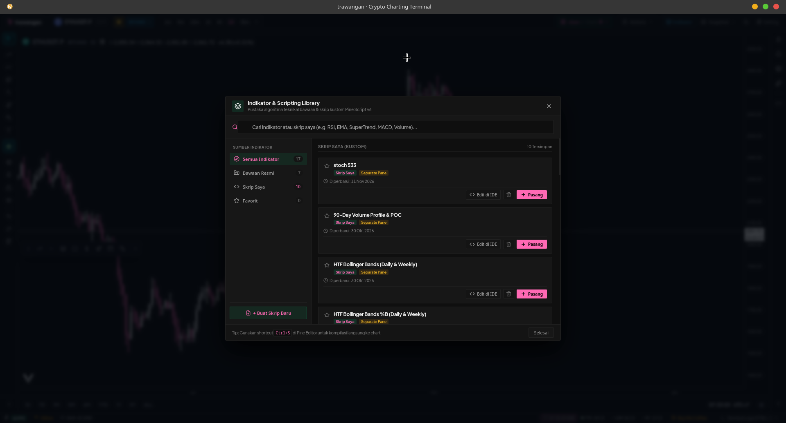
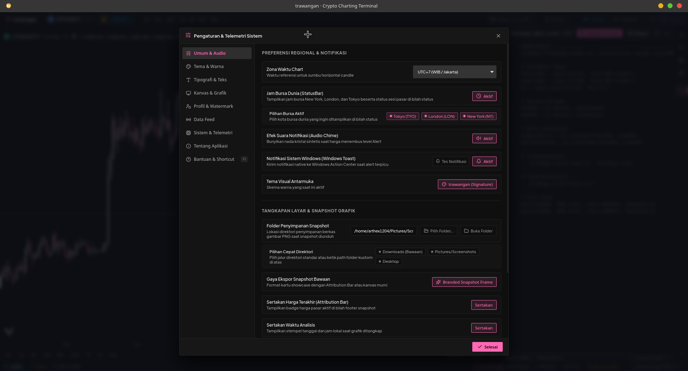
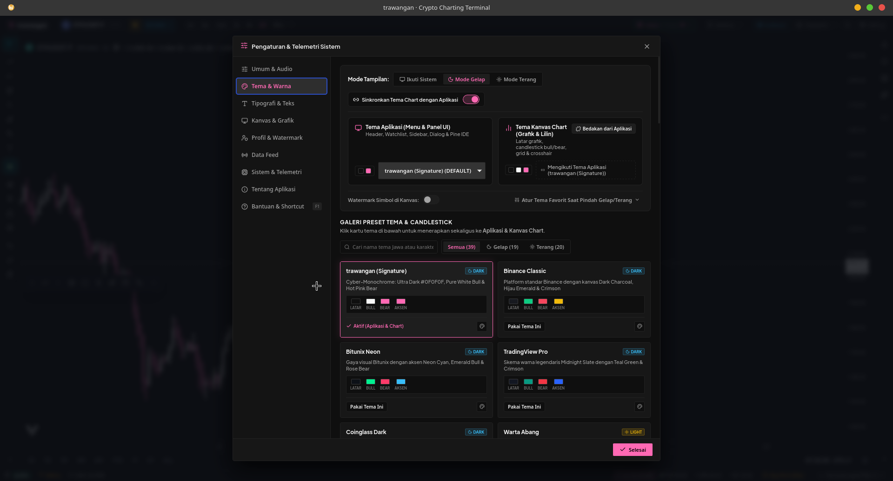

<p align="center">
  
</p>

# ꦠꦿꦮꦔꦤ꧀ · trawangan

> **Desktop Multi-Asset & Crypto Charting Terminal: Zero Paywall**  
> Dibangun di atas **Tauri v2 (Rust Core)**, **Svelte 5 (Runes)**, **LuxAlgo Vela (WebGL2 Engine 120 FPS)**, dan **PineTS v6**.

<p align="center">
  <a href="https://github.com/KaleksananBarqi/trawangan/releases/latest"></a>
  <a href="https://v2.tauri.app/"></a>
  <a href="https://www.rust-lang.org/"></a>
  <a href="https://svelte.dev/"></a>
  <a href="https://www.khronos.org/webgl/"></a>
  
  
  <a href="LICENSE"></a>
</p>

<p align="center">
  <strong>Landing Page Resmi:</strong> <a href="https://kaleksananbarqi.github.io/trawangan/">https://kaleksananbarqi.github.io/trawangan/</a>
</p>

---

## Filosofi & Pure Charting Scope

Nama **trawangan** berasal dari kosakata Jawa *penerawangan* (ꦠꦿꦮꦔꦤ꧀), yaitu ketajaman melihat menembus kabut ilusi dan kesimpangsiuran situasi.

Di tengah platform charting komersial yang membatasi jumlah indikator, layout multi-chart, dan skrip di balik biaya langganan bulanan, **trawangan** mengembalikan kendali penuh meja analisis ke tangan penggunanya. Seluruh grafik, indikator, daftar pantau, skrip Pine v6, hingga arsip rencana trading berjalan secara lokal tanpa paywall, baik untuk pasar kripto, indeks makro kripto, saham Indonesia (IDX), komoditas logam mulia USD, maupun indeks AS.

> [!IMPORTANT]
> **Disiplin Batas (Pure Charting Scope, ADR-0001):**  
> `trawangan` berfokus murni pada visualisasi harga WebGL2, indikator teknikal, manajemen rencana trading berbasis R-multiple, dan riset skrip Pine Script v6. Aplikasi ini sengaja tidak menyediakan tombol eksekusi order Buy/Sell maupun integrasi API key bursa dan dompet Web3 agar analisis harga bebas dari risiko kredensial dan klik order impulsif.

---

## Komparasi Fitur: Zero-Paywall Parity

Seluruh kapabilitas inti tersedia langsung di desktop tanpa tingkatan paket berbayar.

| Fitur / Kapabilitas | `trawangan` v0.45.0 (Desktop Native) | Platform Komersial Gratis |
| :--- | :---: | :---: |
| **Indikator Simultan** | **Tanpa batas di satu kanvas** | Dibatasi (umumnya 2 - 3 indikator) |
| **Alat Gambar Teknikal** | **76 varian lengkap + Gesture Inking multi-pane** | Sebagian dikunci di paket berbayar |
| **Gesture Drawing Engine** | **Draw by Holding (`Shift+D` / `~`) & Scribble Erase** | Tidak tersedia |
| **Multi-Chart Grid Layout** | **Bebas penuh (1, 2, 2H, 4 sel) + kloning `Save As`** | Multi-chart dikunci di langganan bulanan |
| **Kapasitas Watchlist** | **Multi-Watchlist, section dividers & Bintang Header 1-klik** | Dibatasi kuota simbol & kategori |
| **Eksekusi Pine Script v6** | **CodeMirror 6 IDE + Web Worker PineTS lokal** | Dibatasi antrean & kompilasi server |
| **Manajemen Trading Plan** | **Tab persisten `Plan` (Form, Markdown 2-arah, Vault), Dual-Entry & Edit In-Place** | Wajib tarik kotak & hitung R manual |
| **Kalkulasi R & Zona Konteks** | **Auto R-Multiple (`+R` / `-1.00R`), Entry Zone Box & POI Context Zones** | Statis / manual |
| **Ekspor Tangkapan Layar** | **Ultra HD 2x - 6x (~11520x6480) + Thesis Side Panel** | Resolusi standar 1x |
| **Atribusi & Watermark** | **Profil Trader offline + Watermark diagonal (-32°)** | Watermark platform bawaan |
| **Sistem Tema & Kontras** | **37 preset resmi (31 tema Jawa + Warta Abang), Dual-Theme Decoupling & WCAG AA** | Pilihan tema terbatas & tidak terpisah |
| **Cakupan Pasar & Makro** | **Binance, Indodax IDR, Bitunix, Hyperliquid, Coinbase, Yahoo Finance (IDX, COMEX, US Index), Makro Kripto (`TOTAL` 1-3, `OTHERS`, `BTC.D`/`ETH.D`/`USDT.D`), & Custom Node** | Data bursa / indeks tambahan sering berbayar |
| **Background Alert & Stream Guard** | **Evaluasi latar instrumen bursa + Watchdog 30 detik & Audio Chime** | Kuota alert ketat (sering maks. 5) |
| **Penyimpanan & Privasi** | **100% lokal di SQLite (`rusqlite`), Workspace State v2 & Exit Flush** | Pelacak cloud & iklan promo |
| **Konsumsi Memori (RAM)** | **Ringan ~30 - 50 MB (terukur 45.0 MB pada sesi desktop aktif)** | 500 MB - 1.5 GB (tab browser / Electron) |
| **Biaya Penggunaan** | **Rp 0 / $0 selamanya (Lisensi MIT)** | $14.95 - $59.95 / bulan |

---

## Kapabilitas Utama (v0.16 - v0.45.0)

### 1. Crypto Macro Index & Isolasi Beban Latar Nol (`v0.45.0`, `ADR-0024`)
Analisis kapitalisasi pasar total (`TOTAL`, `TOTAL2`, `TOTAL3`, `OTHERS`) serta indeks dominasi (`BTC.D`, `ETH.D`, `USDT.D`) kini tersedia langsung di kategori **Makro Kripto** lewat pencarian `Ctrl+K` (mendukung alias `TOTAL1`, `CRYPTOCAP`, `BTCD`, `ETHD`, `USDTD`) tanpa membutuhkan API key berbayar maupun prefiks bursa manual.

Komposit candle dihitung secara lokal melalui pipeline `macro` memakai daftar Top-30 koin non-wrapped CoinGecko (mengecualikan token wrapped/liquid-staked agar tidak terjadi penghitungan ganda) plus kalibrasi `/global`, riwayat suplai stablecoin harian dari **DefiLlama Stablecoins API**, dan OHLC multi-timeframe **Binance Spot** dengan failover otomatis ke **Coinbase Exchange**. Seluruh hasil sintesis disimpan di SQLite lokal (`macro:<SYMBOL>`), dilengkapi pemformat sumbu `T`/`B`/`%` per sel yang tetap menjaga keutuhan simbol biasa, serta menayangkan lencana `SYNTHETIC (~1Y)` secara transparan. Sesuai kebijakan **Beban Latar Nol (*Strict Active-Chart Only*)**, feeder makro hanya menyala lewat polling batch ~10 detik saat grafiknya benar-benar sedang dibuka dan tidak dijalankan di latar belakang oleh Watchlist maupun `Background Alert Engine`.

### 2. Workspace State v2, Multi-Cell Hybrid Restore & Exit Flush (`v0.43.0`, `ADR-0023`)
Menata tata letak kerja multi-sel (`1`, `2`, `2H`, `4`) tidak lagi berisiko ter-reset saat indikator asinkron selesai dimuat atau jendela aplikasi ditutup mendadak. Skema persistensi **Workspace State v2** memigrasikan dokumen lama secara otomatis dan mengidentifikasi tiap sub-pane berdasarkan **Pane Signature** (sehingga tinggi proporsi osilator dan panel Volume native tetap terjaga).

Setiap sel menyimpan simbol, timeframe, gaya harga, posisi pengguliran historis (`visibleRange` saat meninjau masa lalu), indikator non-tersinkronisasi, geometri `FloatingThesisCard`, status Magnet/Stay pada `DrawingToolbar`, hingga gambar teknikal terpisah yang otomatis ikut terkloning saat Anda memakai **Save As**. Koordinator auto-save bekerja dengan debounce 1500 ms dan diperkuat oleh **Exit Flush** (`beforeunload` dan Tauri `onCloseRequested`) untuk mengamankan perubahan terakhir sebelum SQLite menutup transaksi.

### 3. Docked Perimeter Shell & Quick Watchlist 1-Klik (`v0.44.0`, Spec `#164`)
Seluruh kendali antarmuka tertata di perimeter kanvas agar lilin harga tetap memperoleh ruang pandang luas: Header atas setinggi 40px memuat pencarian `Ctrl+K`, tombol Bintang **Quick Watchlist 1-klik** untuk menyematkan atau melepas simbol aktif langsung dari Header, pemilih bursa, bar timeframe cepat, dan switcher layout workspace.

Bilah status bawah (26px) menampilkan metrik live `FPS`, latensi koneksi, penanda delay atau status `SYNTHETIC (~1Y)`, serta konsumsi `RAM` di kluster kiri berdampingan dengan jam pasar global (`TYO`, `LON`, `NY`, `WIB`). Sejak rilis v0.44.0, komponen `Chart Deep Link Bridge`, userscript ekstensi browser, dan watcher clipboard eksternal telah dihapus sepenuhnya agar terminal berjalan 100% mandiri tanpa ketergantungan skrip peramban.

### 4. Data Feed Multi-Aset Gratis & Deep Stream Health Guard (`v0.40.0 - v0.41.0`, `ADR-0021`)
Perpindahan antar-kelas aset berlangsung otomatis mengikuti konteks simbol tanpa pengaturan provider manual lewat **Dynamic Feeder Context**:
- Kripto spot dan perpetual: **Binance** (Spot & `.P`), **Indodax** (IDR asli), **Bitunix**, **Hyperliquid**, dan **Coinbase**, plus **Custom REST/WS Node** dengan hot-reload.
- Pasar tradisional via Yahoo Finance gratis tanpa API key: **Saham IDX** (`BBCA.JK`, `BBRI.JK`, `TLKM.JK`, `^JKSE`), **Emas & Perak COMEX** (`GC=F`, `SI=F` dengan alias `GOLD` / `XAUUSD`), serta **Indeks & ETF AS** (`^IXIC`, `^NDX`, `^GSPC`, `QQQ`). Termasuk resampling `2H` dan `4H` di sisi klien, penanda transparan `DELAYED 15M`, serta pembatasan polling agar menghormati jam perdagangan bursa aktif.
- Seluruh koneksi dilindungi oleh **Deep Stream Health Guard** dengan watchdog stream diam 30 detik, verifikasi ulang tail candle REST guna membedakan pair sepi likuiditas dari jaringan terputus, dan pemulihan otomatis saat koneksi kembali stabil.

### 5. Tab Persisten Plan, Dual-Entry & POI Context Zones (`v0.37 - v0.43`, `ADR-0014` - `ADR-0020`)
Menyusun dan memperbarui rencana trading terpusat di **Tab `Plan`** pada panel kanan (`Ctrl+Shift+P` atau tempel draf langsung di kanvas dengan `Ctrl+V`). Tiga sub-mode bekerja saling sinkron: **Form** terstruktur, editor **Teks Markdown 2-arah lossless**, dan arsip **Trade Plan Vault**.

Dari jangkar yang digeser di kanvas atau tombol Edit pada `Layers` maupun `FloatingThesisCard`, Anda dapat melakukan penyuntingan **in-place atomik** tanpa menggandakan gambar, lengkap dengan *Dirty Guard* dan commit cepat `Ctrl+Enter`. Sistem menghitung otomatis **Dual-Entry** berbobot (`E1` & `E2` plus `Blended Entry`), memproyeksikan kotak **Entry Zone**, merender **POI Context Zones** transparan (`FVG`, `Order Block`, `IDM`, `Demand`, `Supply`), menghitung R-multiple dinamis (`+R` / `-1.00R`), serta mendaftarkan **Plan-Linked Auto-Alerts** yang ikut bersih saat setup dihapus.

### 6. Dual-Theme Decoupling, 37 Preset Resmi & Kontras WCAG AA (`v0.31 - v0.42`, `ADR-0016` - `ADR-0022`)
Tema antarmuka aplikasi (`App Theme`) dan tema kanvas grafik (`Chart Canvas Theme`) dapat disinkronkan atau dipisahkan secara independen dengan memori terpisah untuk mode gelap (`activeDarkChartPreset`) dan terang (`activeLightChartPreset`), didukung sakelar Header (*Ikuti Sistem / Gelap / Terang*) dan *System Theme Bridge*.

Tersedia **37 preset resmi** bawaan (**18 gelap** dan **19 terang**), mencakup 5 tema bursa/terminal klasik (`Signature`, `Binance Classic`, `Bitunix Neon`, `TradingView Pro`, `Coinglass Dark`), tema kertas **Warta Abang** (`red_folder`), serta **31 preset bernuansa budaya Jawa** (`Ngrembaka`, `Kopi Tubruk`, `Samodra Wengi`, `Lembayung Awan`, `Ayem Tentrem`, `Surya Baskara`, `Wates Dhuwur`, dan lainnya). Seluruh token teks utama dan aksen dijaga rasio kontrasnya `>= 4.5:1` (WCAG 2.1 AA), sementara **Studio 9D** memungkinkan modifikasi langsung 6 elemen lilin dan 3 warna bidang kanvas, `Save As`, serta ekspor/impor preset JSON.

### 7. Pine Script v6 IDE, Gesture Engine & Snapshot Ultra HD 6x (`v0.25 - v0.44`)
- **Side-by-Side Pine Script v6 IDE (`Alt+E`):** Editor modern **CodeMirror 6** berdampingan dengan grafik yang mengeksekusi **PineTS v6** secara lokal di Web Worker terisolasi lengkap dengan `Console & Tester`, `7` indikator bawaan resmi, dan pustaka skrip kustom SQLite tanpa batas jumlah di satu kanvas.
- **Draw by Holding (`Shift+D` / `~`) & Scribble Erase:** Tahan tombol dan goreskan kursor di pane harga utama maupun sub-pane indikator untuk menggambar Trend Line, Ray, Vertical Line, Box, Ellipse, Fib Retracement, Arrow, atau Path; coret zig-zag di atas objek untuk menghapus seketika dengan Undo/Redo (`Ctrl+Z` / `Ctrl+Y`).
- **Side-by-Side Snapshot Ultra HD (`Ctrl+Shift+S`):** Ekspor gambar bersih hingga resolusi **6x (~11520x6480)** beserta panel tesis di sisi kanan (~380px), kartu atribusi profil trader offline adaptif luminansi, dan watermark anti-pencurian (-32°).

### 8. Background Alert Engine & Jam Bursa Dunia (`v0.21 - v0.39`)
Evaluasi `Price Alert` untuk simbol bursa (kripto, IDX, COMEX, indeks AS) terus berjalan di latar meskipun instrumen tersebut tidak sedang dibuka di kanvas, memicu nada sintetis kristal **Audio Chime** dan notifikasi desktop native (termasuk Windows Toast). Bilah bawah memantau sesi perdagangan **Tokyo (`TYO`)**, **London (`LON`)**, **New York (`NY`)**, serta waktu lokal **WIB (`UTC+7`)**.

---

## Galeri Tampilan Antarmuka (1920x1036)

### 1. Terminal Charting Utama & WebGL2 Vela Engine
Grafik `ETHUSDT.P` (Bitunix `1D`) dalam skema Signature Cyber-Monochrome (`#0F0F0F`, lilin White Bull & Hot Pink Bear), menampilkan Header 40px dengan tombol Bintang Quick Watchlist, Toolbar Kiri, dan StatusBar bawah (`62 FPS`, `278ms`, `RAM: 45.0MB`, serta jam sesi bursa global).

<p align="center">
  
</p>

### 2. Panel Watchlist Lintas Bursa & Bilah Alat Favorit
Dock kanan Watchlist aktif menata daftar pantau multi-bursa (`BINANCE .P` dan `BITUNIX`) dengan angka harga serta persentase 24 jam sejajar monospasi, berdampingan dengan strip pintas alat gambar favorit di kiri bawah kanvas.

<p align="center">
  
</p>

### 3. Side-by-Side Pine Script v6 IDE (CodeMirror 6 + Web Worker)
Sunting skrip Pine v6 (`Trawangan_Alpha_v6.pine`) dengan indikator status `SIAP`, aksi `Tambah ke Chart` dan `Simpan`, serta laci `Console & Tester` di samping kanvas grafik yang tetap responsif.

<p align="center">
  
</p>

### 4. Indikator & Scripting Library Lokal
Kelola 7 indikator bawaan resmi dan koleksi skrip kustom tersimpan di SQLite (`Skrip Saya`) dengan akses langsung `Edit di IDE`, `+ Buat Skrip Baru`, dan `+ Pasang` tanpa pembatasan kuota.

<p align="center">
  
</p>

### 5. Pengaturan Terminal, Audio Chime & Branded Snapshot Frame
Sesuaikan zona waktu sumbu grafik (`UTC+7 WIB / Jakarta`), kota pada `Jam Bursa Dunia`, efek suara `Audio Chime`, notifikasi sistem native, folder simpan PNG, dan tata letak `Branded Snapshot Frame`.

<p align="center">
  
</p>

### 6. Dual-Theme Decoupling & Galeri Preset Tema (37 Preset Resmi)
Pisahkan tema shell aplikasi dari tema kanvas grafik, beralih cepat antar mode `Ikuti Sistem / Gelap / Terang`, dan pilih dari 37 preset resmi (termasuk `Signature`, `Binance Classic`, `Bitunix Neon`, `TradingView Pro`, `Coinglass Dark`, `Warta Abang`, serta 31 tema budaya Jawa) maupun preset kustom tersimpan lengkap dengan 4 swatch warna.

<p align="center">
  
</p>

---

## Cheatsheet Pintasan Keyboard

Seluruh navigasi, alat gambar, dan pengelolaan rencana trading dapat dijalankan langsung dari keyboard.

| Pintasan Keyboard | Fungsi di Terminal |
| :--- | :--- |
| <kbd>Ctrl + K</kbd> atau Ketik Huruf | Buka modal pencarian simbol (kripto, indeks makro `TOTAL`/`BTC.D`, IDX, COMEX, indeks AS). |
| Ketik Angka (<kbd>1</kbd>, <kbd>15</kbd>, <kbd>240</kbd>...) | Buka bilah ganti timeframe cepat langsung di atas kanvas (`2H`/`4H` didukung otomatis). |
| <kbd>Shift + D</kbd> atau tahan <kbd>~</kbd> | **Draw by Holding:** Goreskan bentuk teknikal langsung di pane harga atau sub-pane indikator. |
| <kbd>H</kbd> | Beralih antara mode geser kanvas Hand-Pull dan kursor biasa. |
| <kbd>Ctrl + Shift + P</kbd> | Buka tab `Plan` di panel kanan (Form, Teks Markdown 2-arah, Trade Plan Vault). |
| <kbd>Ctrl + Enter</kbd> | Terapkan rencana trading baru atau simpan pembaruan *in-place* pada tab `Plan`. |
| <kbd>Ctrl + V</kbd> (pada Kanvas) | Tempel draf teks/Markdown trading plan langsung ke editor tab `Plan`. |
| <kbd>Ctrl + Shift + S</kbd> | Ekspor dan salin snapshot Ultra HD berbingkai Branded Frame ke clipboard. |
| <kbd>Alt + W</kbd> / <kbd>Alt + O</kbd> | Buka atau tutup panel kanan **Watchlist** (`Alt+W`) dan **Layers / Object Tree** (`Alt+O`). |
| <kbd>Alt + T</kbd> / <kbd>Alt + E</kbd> | Toggle **Left Drawing Toolbar** (`Alt+T`) atau **Pine Script v6 IDE** (`Alt+E`). |
| <kbd>/</kbd> atau <kbd>Ctrl + I</kbd> | Buka modal katalog **Indikator & Scripting Library**. |
| <kbd>Alt + H</kbd> / <kbd>Alt + V</kbd> / <kbd>Alt + B</kbd> / <kbd>Alt + F</kbd> / <kbd>Alt + M</kbd> / <kbd>Alt + R</kbd> | Aktifkan alat Horizontal Line (`Alt+H`), Vertical Line (`Alt+V`), Box (`Alt+B`), Fibonacci (`Alt+F`), Measure (`Alt+M`), atau Posisi Long/Short (`Alt+R`). |
| <kbd>Alt + A</kbd> | Buat Price Alert cepat pada harga posisi kursor saat ini. |
| <kbd>Ctrl + D</kbd> | Gandakan objek gambar terpilih dengan pergeseran posisi otomatis agar tidak saling menumpuk. |
| <kbd>Alt + K</kbd> / <kbd>Alt + L</kbd> | Sembunyikan/tampilkan (`Alt+K`) atau kunci/buka kunci (`Alt+L`) seluruh objek gambar di sel aktif. |
| <kbd>Del</kbd> / <kbd>Backspace</kbd> / <kbd>Ctrl + Del</kbd> | Hapus gambar terpilih (`Del`/`Backspace`) atau bersihkan seluruh gambar di grafik aktif (`Ctrl+Del`). |
| <kbd>Ctrl + Z</kbd> / <kbd>Ctrl + Y</kbd> | Undo dan Redo manipulasi gambar di kanvas (`Ctrl+Shift+Z` juga didukung untuk Redo). |
| <kbd>Alt + Z</kbd> / <kbd>F</kbd> / <kbd>Alt + I</kbd> | Auto-Fit viewport ke rentang data historis (`Alt+Z` atau `F`) dan balik skala harga (`Alt+I`). |
| <kbd>Shift + R</kbd> | Masuk atau keluar mode simulasi **Bar Replay** (`Space` play/pause, `←` / `→` langkah bar). |
| <kbd>Space</kbd> / <kbd>Alt + ↑↓</kbd> | Pindah ke simbol berikutnya (`Space` / `Alt+↓`) atau sebelumnya (`Shift+Space` / `Alt+↑`) di Watchlist. |
| <kbd>Ctrl + ,</kbd> / <kbd>Ctrl + &#96;</kbd> | Buka modal Pengaturan (`Ctrl+,`) atau laci Terminal Diagnostics & Log (<kbd>Ctrl+&#96;</kbd>). |
| <kbd>F1</kbd>, <kbd>?</kbd>, <kbd>F11</kbd> | Buka Pusat Pintasan Keyboard (`F1` / `?`) atau toggle Layar Penuh (`F11` / `Shift+F`). |

---

## Identitas Visual Signature & Tech Stack

**Palet Bawaan Signature Cyber-Monochrome:**
- Kanvas Background: `#0F0F0F` dengan garis grid monokrom redup
- Candlestick Bullish: `#F7F7F7` (badan, garis batas, dan sumbu putih gading)
- Candlestick Bearish & Aksen Primer: `#FF69B4` (badan & sumbu hot pink, garis batas `#CC5A7F`)
- Tipografi: **Plus Jakarta Sans** untuk antarmuka UI dan **JetBrains Mono** (`tabular-nums`) untuk angka harga, rasio R, dan telemetri
- Koleksi Preset: **37 preset resmi** (18 gelap & 19 terang, meliputi tema klasik, `Warta Abang`, dan 31 tema budaya Jawa) ditambah studio kustom 9D tanpa batas

**Tumpukan Teknologi:**
- **Desktop Framework:** [Tauri v2](https://v2.tauri.app/) (Rust Core)
- **Frontend Framework:** [Svelte 5](https://svelte.dev/) (Runes) & SvelteKit SPA (`adapter-static`)
- **Bundler & Tooling:** [Vite](https://vitejs.dev/) & TypeScript
- **Chart Renderer:** [@luxalgo/vela](https://github.com/luxalgo/vela) (WebGL2 120 FPS Engine)
- **Scripting Engine:** [@luxalgo/vela-pinets](https://github.com/luxalgo/vela) & [PineTS](https://github.com/luxalgo/pinets)
- **Code Editor:** [CodeMirror 6](https://codemirror.net/)
- **Database:** SQLite lokal (embedded Rust via `rusqlite`)
- **Icons:** [Lucide Svelte](https://lucide.dev/)

---

## Pengembangan Lokal & Build Multi-Platform

### Prasyarat Sistem
- [Node.js](https://nodejs.org/) (v20+)
- [Rust & Cargo](https://rustup.rs/) (stable)
- **Windows:** C++ Build Tools & WebView2 (bawaan Windows 10/11)
- **Linux:** `libwebkit2gtk-4.1-dev`, `build-essential`, `curl`, `wget`, `file`, `libxdo-dev`, `libssl-dev`, `libayatana-appindicator3-dev`, `librsvg2-dev`, `patchelf`, `libfuse2`
- **macOS:** Xcode Command Line Tools

### Menjalankan Mode Pengembangan
```bash
git clone https://github.com/KaleksananBarqi/trawangan.git
cd trawangan
npm ci
npm run tauri dev
```

### Build Installer Lokal
```bash
npm run tauri build
```
Paket hasil kompilasi (`.exe` NSIS & `.msi` di Windows, `.AppImage`, `.deb`, & `.rpm` di Linux, `.dmg` & `.app.tar.gz` di macOS) tersimpan di `src-tauri/target/release/bundle/`.

### Rilis Otomatis Multi-Platform (GitHub Actions)
Workflow `.github/workflows/release.yml` membangun biner untuk Windows, Linux, dan macOS secara paralel:
1. **Melalui Git Tag:**
   ```bash
   git tag -a v0.45.0 -m "Release v0.45.0"
   git push origin v0.45.0
   ```
2. **Melalui GitHub CLI:**
   ```bash
   gh workflow run release.yml -f tag=v0.45.0
   ```
3. **Melalui GitHub Actions UI:** Buka tab **Actions** -> pilih **release trawangan** -> klik **Run workflow** -> isi tag rilis (misalnya `v0.45.0`).

---

## Keputusan Arsitektur (ADR)

Seluruh desain subsistem dan batasan performa `trawangan` terdokumentasi di Architecture Decision Records:
- [ADR 0001: Brand Identity, Signature Theme, and Pure Charting Scope](docs/adr/0001-brand-identity-and-theming-system.md)
- [ADR 0002: Distribution Strategy and Self-Contained Landing Page Architecture](docs/adr/0002-distribution-and-landing-page-strategy.md)
- [ADR 0003: Core Architecture and Lightweight Guardrails Specification](docs/adr/0003-core-architecture-and-lightweight-guardrails.md)
- [ADR 0004: Docked Structural Shell and Persistent Side-by-Side Pine IDE](docs/adr/0004-docked-structural-shell-and-side-by-side-ide.md)
- [ADR 0005: Multi-Quote Indodax Integration, Feed Connection Guard, and Deep Workspace Persistence](docs/adr/0005-multi-quote-feed-guard-and-workspace-layout-persistence.md)
- [ADR 0006: Exchange-Aware Drawing Isolation and Multi-Provider Watchlist Architecture](docs/adr/0006-exchange-aware-drawings-and-multi-provider-watchlist.md)
- [ADR 0007: Unified Object Tree and Browser Deep Link Bridge Architecture](docs/adr/0007-unified-object-tree-and-browser-deep-link-bridge.md)
- [ADR 0008: Multi-Watchlist Registry and Section Dividers Architecture](docs/adr/0008-multi-watchlist-registry-and-section-dividers.md)
- [ADR 0009: Dual-Track Volume Architecture and Session VWAP Integration](docs/adr/0009-dual-track-volume-and-session-vwap.md)
- [ADR 0010: OHLC Magnet Snapping, Tick-Aligned Price Guard, and Alert Management Revamp](docs/adr/0010-magnet-snapping-and-alert-management-revamp.md)
- [ADR 0011: Hybrid Symbol Logo and Adaptive Quote Engine](docs/adr/0011-hybrid-symbol-logo-and-adaptive-quote-engine.md)
- [ADR 0012: Offline Branded Snapshot Engine and Attribution Frame](docs/adr/0012-offline-branded-snapshot-engine-and-attribution-frame.md)
- [ADR 0013: Draw by Holding Gesture Engine and Shortcut Revamp](docs/adr/0013-draw-by-holding-gesture-engine-and-shortcut-revamp.md)
- [ADR 0014: Deterministic Trading Plan Ingestion and Multi-Target Positions](docs/adr/0014-deterministic-trading-plan-ingestion-and-multi-target-positions.md)
- [ADR 0015: Trader Profile Attribution, Security Watermark, and Custom Canvas Background](docs/adr/0015-trader-profile-security-watermark-and-custom-canvas-background.md)
- [ADR 0016: Unified Theme Engine, Full Palette Matrix, and Cross-Subsystem Propagation](docs/adr/0016-unified-theme-engine-full-palette-matrix-and-cross-subsystem-propagation.md)
- [ADR 0017: Dual-Theme Decoupling, User Theme Presets, System Bridge, and Background Alert Engine](docs/adr/0017-dual-theme-decoupling-user-theme-presets-and-background-alert-engine.md)
- [ADR 0018: Live Theme Preview, Chart Context Menu Pruning, In-Place Palette Editing, Canvas Watermark Control, and Workspace Auto-Save Guard](docs/adr/0018-live-theme-preview-chart-context-menu-pruning-in-place-palette-editing-and-canvas-watermark-control.md)
- [ADR 0019: Chart Mode Preset Memory, Chart-Dominant Thesis Surface, Trade Plan Vault, and Plan-Linked Auto-Alerts](docs/adr/0019-chart-mode-preset-memory-chart-dominant-thesis-trade-plan-vault-and-auto-alerts.md)
- [ADR 0020: Dual-Entry, Blended Trading Plan Ingestion, and Entry Zone Projection](docs/adr/0020-dual-entry-blended-trading-plan-and-entry-zone-projection.md)
- [ADR 0021: Yahoo Finance Provider, Multi-Asset Support, and Dynamic Feeder Context](docs/adr/0021-yahoo-finance-provider-and-dynamic-feeder-routing.md)
- [ADR 0022: Koleksi Preset Tema Jawa, Evolusi Warta Abang, dan Token Kontras Adaptif WCAG](docs/adr/0022-javanese-theme-preset-collection-and-contrast-tokens.md)
- [ADR 0023: Skema Workspace State v2, Tata Letak Pane Bawah Adaptif, Multi-Cell Hybrid Restore, dan Kelengkapan Sesi](docs/adr/0023-workspace-state-v2-pane-layout-and-per-cell-persistence.md)
- [ADR 0024: Crypto Macro Index and Calibrated Synthetic Basket Feeder](docs/adr/0024-crypto-macro-index-and-synthetic-basket-feeder.md)

---

## Lisensi
Didistribusikan di bawah lisensi terbuka **MIT License**. Lihat berkas [LICENSE](LICENSE) untuk rincian lengkap.
